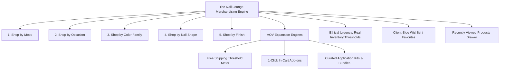
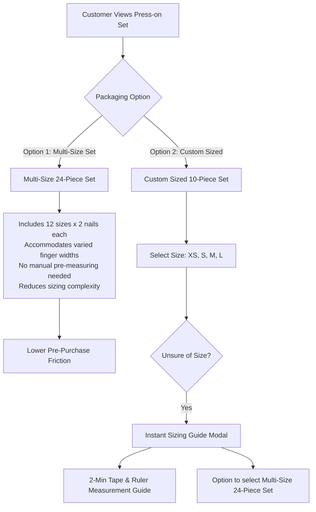

# The Nail Lounge — Conversion & Merchandising Strategy
**Document Version:** 1.0.0  
**Status:** Approved Blueprint for Phase 0  

---

## 1. Commercial Strategy & Merchandising Hierarchy

In digital beauty e-commerce, customers do not merely purchase a physical product—they purchase a look, a mood, and an emotional transformation. A static, flat product catalog fails to trigger visual desire.

The Nail Lounge employs a multi-dimensional merchandising strategy that categorizes inventory across five distinct discovery axes while maintaining strict adherence to ethical persuasion.

---

## 2. Multi-Dimensional Discovery Axes

| Discovery Axis | Attribute Values / Taxonomies | Architectural Placement | Commercial & UX Value |
| :--- | :--- | :--- | :--- |
| **Shop by Mood** | • *Soft Glam & Romantic* • *Clean Girl Minimalist* • *Bold & Edgy* • *Whimsical & Playful* | • Homepage visual carousel • Main navigation menu • Collection index | Converts casual browsers who have a personal aesthetic in mind but no specific technical nail knowledge. |
| **Shop by Occasion** | • *Bridal & Weddings* • *Festive & Celebrations* • *Date Night & Evening* • *Everyday Office / Workwear* • *Vacation & Resort* | • Homepage editorial feature • Collection pages • Seasonal marketing landing pages | Aligns with high-urgency, date-driven shopping needs. Increases willingness to pay for premium embellished sets. |
| **Shop by Color Family** | • *Nudes & Warm Neutrals* • *Blush & Soft Pinks* • *Deep Wine, Berries & Reds* • *French Tip Classics* • *Glazed Chrome & Whites* • *Midnight & Moody Blacks* | • Catalog faceted sidebar • Visual color swatch circles on category pages | Color is the fastest visual filter on mobile devices. Allows instant matching with outfits or accessories. |
| **Shop by Nail Shape** | • *Almond (Elegant & elongating)* • *Coffin / Ballerina (Bold & trendy)* • *Square (Classic & modern)* • *Oval (Soft & natural)* • *Stiletto (Drama & statement)* • *Squoval (Universal daily wear)* | • Catalog filter sidebar • Shape visual selector on PDP • Header "Nail Shapes" submenu | Nail enthusiasts are fiercely loyal to specific shapes that flatter their finger length. Eliminates browsing mismatch. |
| **Shop by Finish** | • *High-Gloss Gel Finish* • *Velvet Matte* • *Glazed Chrome / Hailey Glaze* • *Cat Eye / Magnetic Velvet* • *3D Embossed & Rhinestone* | • Catalog faceted filters • PDP technical specifications badge | Differentiates handmade luxury press-on nails from flat, mass-produced machine tips. |

---

## 3. Dynamic Merchandising Collections & Badges

### 3.1 New Arrivals
- **Placement:** Homepage dedicated section, catalog sorting option, and dedicated `/collections/new-arrivals` route.
- **Rule:** Automatically tags products created in the database within the last 30 calendar days.
- **Commercial Value:** Drives repeat visits from existing customers looking for fresh designs.

### 3.2 Bestsellers (Data-Backed Only)
- **Ethical Rule:** A product is tagged as a "Bestseller" **only when supported by actual historical sales volume** from the backend database (e.g., top 10% of completed orders over the trailing 60 days).
- **Phase 0/1 Storefront Rule:** Before sufficient transactional volume exists, the storefront **must not** label items with fake "Bestseller" tags. Instead, use an honest editorial badge: **"Curator's Choice"** or **"Studio Favorite"**.

### 3.3 Curated Collections
- Editorial packages (e.g., "The Royal Abohar Bridal Suite", "The Minimalist 9-to-5 Edit").
- Grouped thematically by the merchant with custom banner photography, storytelling blurbs, and styling suggestions.

---

## 4. Average Order Value (AOV) & Basket Size Maximization

### 4.1 The Free Shipping Threshold Progress Meter
- **Placement:** Top utility announcement bar, Product Detail Page, and Slide-out Cart Drawer.
- **Psychological Trigger:** Gamified progress towards unlocking free express shipping.
- **Rule Engine:**
  - Let Free Shipping Minimum = `₹999`.
  - Let Current Cart Subtotal = `S`.
  - If `S < 999`: Display `"Add ₹" + (999 - S) + " more for FREE Express Delivery!"` with an animated progress bar.
  - If `S >= 999`: Display `"🎉 Congratulations! You have unlocked FREE Express Delivery!"`

### 4.2 In-Cart 1-Click Upsells (Impulse Add-ons)
- **Placement:** Directly inside the Slide-out Cart Drawer above the subtotal.
- **Merchandising Principle:** High-margin, low-price complementary necessities that require zero sizing decisions:
  - *Extra-Strength Jelly Glue Tabs (2 Sheets)* — `₹99`
  - *Nourishing Vitamin E Cuticle Oil Pen* — `₹149`
  - *Nail Dehydrator & Sanitizing Prep Wipes (10-pack)* — `₹79`
  - *Crystal Glass Precision Nail File* — `₹129`
- **UX Mechanism:** Single-tap "+" button instantly adds the item to the cart without leaving the drawer.

### 4.3 Genuine Bundles & Complete Nail Kits
- Rather than selling naked press-on sets, offer tiered bundled packages:
  - **The Starter Manicure Set:** 1 Press-on Nail Set + Complete Tool Kit + Cuticle Oil (`Save ₹200 vs buying separately`).
  - **The Bridal Duo:** 2 Complementary Festive Sets + Deluxe Prep Kit + Travel Storage Box (`Save ₹350`).
- **Transparency:** The bundle breakdown explicitly displays the individual price of each constituent item and the genuine bundle discount.

### 4.4 Frequently Purchased Together
- **Rule Engine:** In the initial launch phase (Phase 1–3), complementary recommendations on the PDP are curated manually by the merchant (e.g., Press-on Nail → Glue Tabs + Cuticle Oil).
- **Post-MVP Transition:** Once order volume exceeds 500 completed transactions, an automated backend co-occurrence query identifies items frequently purchased together in the same order (`SELECT item_b FROM OrderItems WHERE item_a IN ...`).

---

## 5. Retention & Friction Reduction Engines

### 5.1 Recently Viewed Products
- **Placement:** Sub-section at the bottom of the Homepage, Catalog, and PDPs.
- **Implementation:** Persisted purely client-side via `localStorage` (storing the last 8 visited product slugs, titles, primary images, and prices).
- **Commercial Value:** Allows shoppers who browse multiple designs to quickly compare and return to earlier styles without having to re-navigate the catalog. Zero server overhead or user account requirement.

### 5.2 Guest Wishlist (Save to Favorites)
- **Placement:** Heart icon on all product cards and PDPs; accessible via a persistent "Saved" icon in the navigation header.
- **Justification & Strategy:** Requiring user registration to save a favorite product destroys wishlisting intent. The Nail Lounge provides a **Guest Wishlist** stored in browser `localStorage`.
- **Conversion Trigger:** When a guest returns to the website, a subtle badge indicator shows their saved items. If an item in their wishlist falls below 3 units in stock, an alert badge appears on their wishlist card.

---

## 6. Sizing Flexibility & Customer Confidence

In press-on nail e-commerce, a primary cause of hesitation is sizing suitability ("Will these fit my natural nail bed?").

The Nail Lounge addresses this with a flexible product model strategy:

Offering **Multi-Size 24-Piece Sets** reduces the initial barrier for first-time shoppers who do not have measurement tape on hand, while offering **Custom Sized 10-Piece Sets** accommodates experienced customers who know their exact nail sizing. Clear sizing charts, printable guides, and millimeter dimensions remain accessible on every product page to prevent fit dissatisfaction.

