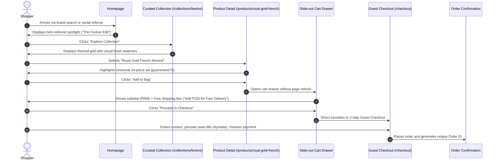
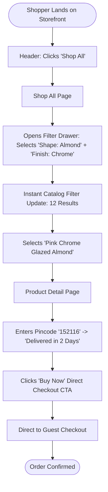
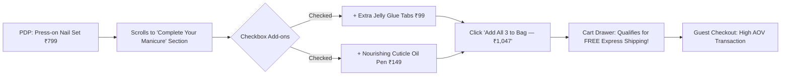
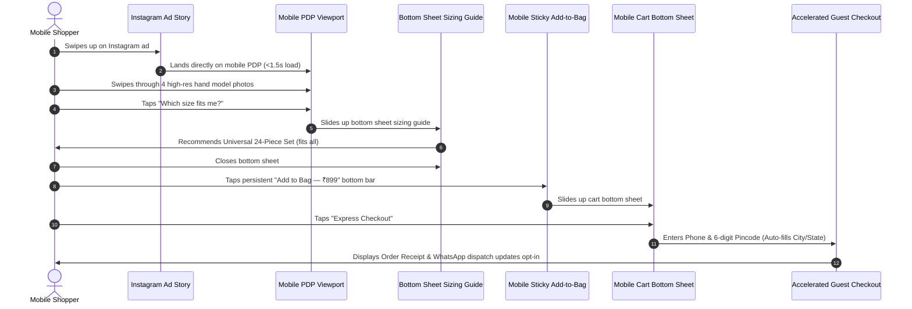

# The Nail Lounge — Customer Journeys & UX Flow Analysis
**Document Version:** 1.0.0  
**Status:** Approved Blueprint for Phase 0  

---

## 1. Journey Overview & Friction Reduction Principles

A core failure of many e-commerce storefronts—especially in beauty—is forcing visitors into rigid, high-friction funnels (mandatory account creation, confusing multi-step checkouts, hidden shipping fees, and sizing uncertainty).

At **The Nail Lounge**, our UX architecture follows four foundational friction-reduction principles:
1. **Zero Registration Barrier:** Guest checkout is the default. Customers should never be forced to create an account or remember a password to buy press-on nails.
2. **Context Preservation:** Adding items to the cart opens an interactive slide-out cart drawer rather than redirecting the shopper away from their browsing context.
3. **Transparent Sizing Upfront:** Default to Universal 24-Piece Sets (which fit 100% of finger sizes out of the box) while offering an effortless 2-minute visual sizing guide for custom 10-piece sets.
4. **Instant Address Acceleration:** Utilizing Indian 6-digit Pincode auto-lookup to populate City and State automatically, reducing mobile typing effort by >40%.

---

## 2. Detailed Customer Journeys

### Journey A: The Editorial Curator
**Path:** Homepage → Curated Collection → Product Detail Page → Slide-out Cart Drawer → Guest Checkout

- **Visitor Mindset:** The shopper wants inspiration for an upcoming festival or event.
- **Key Experience Nodes:**
  - Homepage hero visually communicates premium aesthetic and immediate occasion relevance.
  - Collection page filters out irrelevant styles, reducing cognitive load.
  - PDP immediately answers sizing concerns by pre-selecting the "Universal 24-Piece Set".
- **Friction Points Identified & Eliminated:**
  - *Previous Friction:* Navigating away to a full cart page breaks shopping momentum.  
  - *Elimination:* Cart drawer allows instant review with an immediate checkout trigger.

---

### Journey B: The Precision Shopper
**Path:** Homepage → Shop All Catalog → Faceted Filter & Search → Product Detail Page → Direct Purchase

- **Visitor Mindset:** "I know exactly what I want: a medium almond set with a glazed chrome finish."
- **Key Experience Nodes:**
  - Faceted filter bar updates results without full page reload.
  - Filter pills allow one-tap dismissal of selected criteria.
  - "Buy Now" button bypasses the cart drawer, launching directly into checkout for single-item express shoppers.
- **Friction Points Identified & Eliminated:**
  - *Previous Friction:* Multi-level category trees that bury specific shapes.
  - *Elimination:* Granular filter facets (Shape, Length, Finish) surfaced directly on the catalog page.

---

### Journey C: The Casual Trend Browser
**Path:** Social Media / Casual Landing → Mood & Occasion Collection → Visual Discovery → High-Engagement Purchase

- **Visitor Mindset:** Not initially planning to buy; browsing aesthetic trends or looking for gift ideas.
- **Step-by-Step Flow:**
  1. Lands on Homepage or Collection page via an Instagram Reel or TikTok-style nail tutorial.
  2. Encounters the "Shop by Mood / Occasion" visual grid (e.g., "Clean Girl Aesthetic", "Midnight Velvet", "Bridal Glow").
  3. Explores interactive customer manicure gallery with tagged products.
  4. Clicks a tagged manicure photo to open a quick-view modal.
  5. Selects "Add to Bag" directly from the visual gallery modal.
  6. Sees the Free Shipping progress bar in the cart drawer ("You're ₹150 away from Free Express Delivery!").
  7. Taps "Add Cuticle Oil Pen (₹149)" in the 1-click cart upsell carousel.
  8. Progresses to Guest Checkout.
- **Friction Points Identified & Eliminated:**
  - *Previous Friction:* Dry product-only catalog photos that fail to evoke mood or lifestyle aspiration.
  - *Elimination:* High-resolution lifestyle hand modeling and real-life finish photography.

---

### Journey D: The High-AOV Bundle Builder
**Path:** Product Detail Page → Complementary Product Discovery → Multi-Item High-AOV Cart

- **Visitor Mindset:** "I want to make sure my press-on nails last through a wedding weekend and look like a real salon manicure."
- **Key Experience Nodes:**
  - Strategic cross-sell section directly on the PDP below the main product actions.
  - Pre-selected bundle discounts (e.g., "Prep & Protect Bundle: Add glue tabs + cuticle oil and save 15%").
  - Dynamic cart updates showing instant free shipping qualification.
- **Commercial Impact:** Increases Average Order Value (AOV) from ~₹799 to >₹1,250 and Units Per Transaction (UPT) from 1.0 to 2.5+.

---

### Journey E: The Returning Customer Express Re-order
**Path:** Returning Visitor → Recently Viewed / Quick Search → One-Click Re-order

- **Visitor Mindset:** "I bought a set two weeks ago, loved the quality, and now want a fresh design for the weekend."
- **Step-by-Step Flow:**
  1. Shopper returns to the website on the same mobile device.
  2. The homepage surfaces a subtle "Welcome Back! Pick up where you left off" horizontal carousel of **Recently Viewed Products** stored in `localStorage`.
  3. Shopper taps a previously viewed item directly into the cart drawer.
  4. At checkout, browser auto-fill (or cached guest shipping address in `localStorage`) pre-populates their delivery information.
  5. Shopper confirms delivery speed and completes the order in under 45 seconds.
- **Friction Points Identified & Eliminated:**
  - *Previous Friction:* Forcing returning customers to search the entire catalog again or log into an account.
  - *Elimination:* Zero-login client-side state caching preserves recently viewed items and address fields.

---

### Journey F: The Mobile First-Time Shopper (Meta / Instagram Ad Lander)
**Path:** Mobile Instagram Ad → Mobile Landing PDP → Bottom Sheet Sizing → Sticky CTA → Instant Guest Checkout

- **Visitor Mindset:** Short attention span, browsing while on the move, high sensitivity to slow load times.
- **Key Experience Nodes:**
  - Viewport-optimized layout: Gallery fills top half, critical pricing and sizing visible above the fold.
  - Sizing guide opens as a non-intrusive bottom sheet rather than navigating to a new URL.
  - Sticky bottom CTA ensures the "Add to Bag" button is always within comfortable thumb reach.
  - Form fields use appropriate HTML5 input types (`inputmode="numeric"`, `autocomplete="tel"`, `autocomplete="postal-code"`).

---

## 3. Systematic Friction Audit & Architectural Mitigations

| Friction Area | Common E-Commerce Flaw | The Nail Lounge Architectural Solution |
| :--- | :--- | :--- |
| **Sizing Anxiety** | Customer fears ordering nails that won't fit their natural nail bed. | **Dual Set Model:** Promote Universal 24-Piece Sets (contains 12 sizes x 2 nails) as the default; interactive 2-minute visual measurement modal for custom sets. |
| **Durability Doubts** | Customer wonders if nails will pop off in the shower or during chores. | Transparent wear-time accordion on PDP (Adhesive tabs = 2–4 days; Liquid glue = 2–3 weeks) with video prep steps. |
| **Registration Walls** | Mandatory account sign-up before checking out causes 30%+ drop-off. | **100% Guest Checkout:** Customers simply enter their email/phone and shipping address. |
| **Mobile Form Fatigue** | Filling 12 form fields on a smartphone touchscreen. | **Smart Address Lookup:** Customer enters 6-digit Indian Pincode; backend/API auto-fills State, District, and City. Total input fields reduced to 4. |
| **Shipping Fee Shock** | Customer discovers unexpected ₹150 courier fee at the final checkout step. | Upfront transparency: Free shipping threshold progress bar visible in the header utility bar, PDP, and cart drawer. |
| **Payment Drop-off** | Complex multi-redirect payment gateways failing on slow mobile 4G. | Clean payment selection with immediate Cash on Delivery (COD) / Direct confirmation and clear payment status callbacks. |

