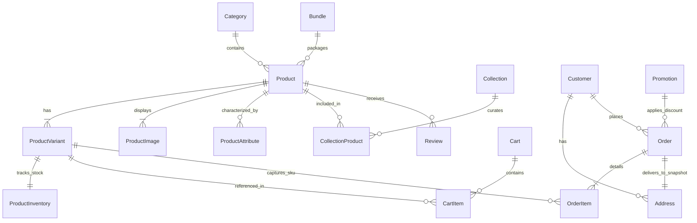

# The Nail Lounge — Database Architecture & Schema Design
**Document Version:** 1.0.0  
**Status:** Approved Blueprint for Phase 0  
**RDBMS:** PostgreSQL  
**ORM:** Prisma  

---

## 1. Entity-Relationship Diagram (ERD)



---

## 2. MVP vs. Future Phase Entities Classification

To ensure rapid, robust initial delivery without architectural bloat, entities are cleanly divided:

| Entity Name | Phase Status | Rationale & Handling |
| :--- | :--- | :--- |
| **Product** | **Essential MVP** | Core catalog entity representing the nail style, accessory, or tool. |
| **ProductVariant** | **Essential MVP** | Manages shapes (Almond, Coffin), sizes (Universal 24-pc vs XS/S/M/L), and pricing. |
| **ProductImage** | **Essential MVP** | Cloudinary asset URLs, display order, alt text, and primary flags. |
| **Category** | **Essential MVP** | Structural catalog hierarchy (Press-ons, Gel Polish, Tools, Kits). |
| **Collection** | **Essential MVP** | Curated lookbooks (Bridal, Festive, Minimalist) with marketing banners. |
| **CollectionProduct** | **Essential MVP** | Many-to-many join table with custom sorting priority within collections. |
| **ProductAttribute** | **Essential MVP** | Faceted search attributes (Finish, Length, Color Family, Mood, Occasion). |
| **ProductInventory** | **Essential MVP** | Atomic stock tracking, reserved quantities, and low-stock threshold triggers. |
| **Customer** | **Essential MVP** | Guest customer record keyed by email/phone; no password required for MVP. |
| **Address** | **Essential MVP** | Structured Indian delivery address with 6-digit postal code. |
| **Cart & CartItem** | **Essential MVP** | Guest cart persistence synced from client session to database upon checkout. |
| **Order & OrderItem** | **Essential MVP** | Immutable order record with snapshot pricing, taxes, and shipping snapshot. |
| **Promotion** | **Phase 2 (MVP+ )** | Coupon code discounts and free shipping rule enforcement. |
| **Bundle** | **Phase 2 (MVP+ )** | Pre-configured kit discounts (e.g., Starter Kit). |
| **Review** | **Phase 3 (Post-MVP)** | Verified customer ratings and feedback (no fake reviews at launch). |
| **RecentlyViewed** | **Client-Side MVP** | Stored in browser `localStorage` during MVP; server entity added in future user accounts. |

---

## 3. Critical E-Commerce Database Patterns

### 3.1 Historical Price Integrity & Product Snapshots
A fatal design flaw in naive e-commerce schemas is referencing the live `ProductVariant.price` or `Product.name` when calculating past order totals. If a merchant changes the price of "Rose Almond" from ₹899 to ₹1,099 next month, historical accounting and past customer invoices must **not** change.

**Solution:** The `OrderItem` table stores immutable snapshot fields:
- `productName`: Snapshot of title at the exact moment of order placement.
- `variantTitle`: Snapshot of size/shape selected (e.g., "Universal 24-Piece").
- `unitPrice`: Snapshot of price charged.
- `discountAmount`: Snapshot of coupon savings allocated to this line item.
- `taxAmount`: Snapshot of GST applied.

### 3.2 Address Immutability Pattern
If a returning guest updates their delivery address on a subsequent visit, past orders must still display where the historical parcel was originally delivered.

**Solution:** The `Order` table stores a complete JSON snapshot (`shippingAddressSnapshot`) or points to an immutable historical address ID.

### 3.3 Product Variant Architecture
For press-on nails, variant dimensions include:
1. **Universal 24-Piece Set:** SKU suffix `-UNI24`. Guaranteed fit for all 10 fingers.
2. **Custom Sized 10-Piece Set:** SKU suffix `-CUST10` with size attribute `XS`, `S`, `M`, or `L`.

---

## 4. Detailed Data Dictionary & Schema Specifications

### 4.1 Core Catalog Tables

#### Table: `categories`
| Column | Type | Nullable | Constraints & Defaults | Description |
| :--- | :--- | :--- | :--- | :--- |
| `id` | `VARCHAR(36)` | NO | PK, `gen_random_uuid()` | Unique category identifier |
| `name` | `VARCHAR(100)`| NO | — | Category display name |
| `slug` | `VARCHAR(120)`| NO | UNIQUE | URL-safe slug (e.g. `press-on-nails`) |
| `description` | `TEXT` | YES| — | Category editorial description |
| `imageUrl` | `VARCHAR(500)`| YES| — | Banner/thumbnail Cloudinary URL |
| `parentId` | `VARCHAR(36)` | YES| FK -> `categories(id)` | Parent category for nesting |
| `sortOrder` | `INTEGER` | NO | DEFAULT `0` | Display sorting priority |
| `isActive` | `BOOLEAN` | NO | DEFAULT `true` | Visibility toggle |
| `createdAt` | `TIMESTAMPTZ` | NO | DEFAULT `NOW()` | Timestamp |
| `updatedAt` | `TIMESTAMPTZ` | NO | DEFAULT `NOW()` | Timestamp |

*Indexes:*
- `CREATE INDEX idx_categories_slug ON categories(slug);`
- `CREATE INDEX idx_categories_parent ON categories(parentId);`

---

#### Table: `products`
| Column | Type | Nullable | Constraints & Defaults | Description |
| :--- | :--- | :--- | :--- | :--- |
| `id` | `VARCHAR(36)` | NO | PK, `gen_random_uuid()` | Unique product identifier |
| `name` | `VARCHAR(255)`| NO | — | Product title (e.g., "Glazed Rose Chrome") |
| `slug` | `VARCHAR(280)`| NO | UNIQUE | URL-safe slug |
| `shortDescription`| `VARCHAR(500)`| YES| — | Brief teaser for catalog cards |
| `description` | `TEXT` | NO | — | Full editorial HTML/Markdown description |
| `categoryId` | `VARCHAR(36)` | NO | FK -> `categories(id)` | Primary product category |
| `basePrice` | `NUMERIC(10,2)`| NO | CHECK (`basePrice >= 0`) | Minimum selling price |
| `compareAtPrice` | `NUMERIC(10,2)`| YES| CHECK (`compareAtPrice >= basePrice`) | Maximum Retail Price (MRP) |
| `isFeatured` | `BOOLEAN` | NO | DEFAULT `false` | Featured on homepage |
| `isActive` | `BOOLEAN` | NO | DEFAULT `true` | Visibility toggle |
| `packageContents` | `TEXT` | YES| — | Box contents list |
| `applicationGuide`| `TEXT` | YES| — | Application steps |
| `removalGuide` | `TEXT` | YES| — | Removal instructions |
| `materialInfo` | `TEXT` | YES| — | Material specifications |
| `countryOfOrigin` | `VARCHAR(100)`| NO | DEFAULT `'India'` | Legal metrology requirement |
| `createdAt` | `TIMESTAMPTZ` | NO | DEFAULT `NOW()` | Timestamp |
| `updatedAt` | `TIMESTAMPTZ` | NO | DEFAULT `NOW()` | Timestamp |

*Indexes:*
- `CREATE INDEX idx_products_slug ON products(slug);`
- `CREATE INDEX idx_products_category ON products(categoryId);`
- `CREATE INDEX idx_products_active_featured ON products(isActive, isFeatured);`

---

#### Table: `product_variants`
| Column | Type | Nullable | Constraints & Defaults | Description |
| :--- | :--- | :--- | :--- | :--- |
| `id` | `VARCHAR(36)` | NO | PK, `gen_random_uuid()` | Unique variant identifier |
| `productId` | `VARCHAR(36)` | NO | FK -> `products(id)` ON DELETE CASCADE | Parent product |
| `sku` | `VARCHAR(100)`| NO | UNIQUE | Stock Keeping Unit |
| `title` | `VARCHAR(150)`| NO | — | Variant name (e.g., "Universal 24 Pcs") |
| `setType` | `VARCHAR(50)` | NO | DEFAULT `'UNIVERSAL_24'` | `'UNIVERSAL_24'` or `'CUSTOM_10'` |
| `size` | `VARCHAR(20)` | YES| — | `XS`, `S`, `M`, `L` (if custom) |
| `shape` | `VARCHAR(50)` | YES| — | `Almond`, `Coffin`, `Square`, `Oval`, `Stiletto` |
| `length` | `VARCHAR(50)` | YES| — | `Short`, `Medium`, `Long` |
| `finish` | `VARCHAR(50)` | YES| — | `Glossy`, `Matte`, `Chrome`, `Glazed` |
| `price` | `NUMERIC(10,2)`| NO | CHECK (`price >= 0`) | Selling price for this variant |
| `compareAtPrice` | `NUMERIC(10,2)`| YES| — | MRP for this variant |
| `createdAt` | `TIMESTAMPTZ` | NO | DEFAULT `NOW()` | Timestamp |

*Indexes:*
- `CREATE INDEX idx_variants_product ON product_variants(productId);`
- `CREATE INDEX idx_variants_sku ON product_variants(sku);`
- `CREATE INDEX idx_variants_shape_finish ON product_variants(shape, finish);`

---

#### Table: `product_inventories`
| Column | Type | Nullable | Constraints & Defaults | Description |
| :--- | :--- | :--- | :--- | :--- |
| `id` | `VARCHAR(36)` | NO | PK, `gen_random_uuid()` | Unique inventory record |
| `variantId` | `VARCHAR(36)` | NO | UNIQUE, FK -> `product_variants(id)` | Associated variant |
| `quantity` | `INTEGER` | NO | DEFAULT `0`, CHECK (`quantity >= 0`) | Physical available stock |
| `reservedQuantity`| `INTEGER` | NO | DEFAULT `0`, CHECK (`reservedQuantity >= 0`) | Held in active checkout |
| `lowStockThreshold`| `INTEGER`| NO | DEFAULT `3` | Triggers "Only X left" alert |
| `updatedAt` | `TIMESTAMPTZ` | NO | DEFAULT `NOW()` | Timestamp |

---

#### Table: `product_images`
| Column | Type | Nullable | Constraints & Defaults | Description |
| :--- | :--- | :--- | :--- | :--- |
| `id` | `VARCHAR(36)` | NO | PK, `gen_random_uuid()` | Unique image record |
| `productId` | `VARCHAR(36)` | NO | FK -> `products(id)` ON DELETE CASCADE | Associated product |
| `publicId` | `VARCHAR(255)`| NO | — | Cloudinary public ID |
| `url` | `VARCHAR(500)`| NO | — | Cloudinary HTTPS secure URL |
| `altText` | `VARCHAR(255)`| YES| — | Accessibility alt text |
| `sortOrder` | `INTEGER` | NO | DEFAULT `0` | Order in gallery |
| `isPrimary` | `BOOLEAN` | NO | DEFAULT `false` | Main catalog thumbnail |

*Indexes:*
- `CREATE INDEX idx_images_product ON product_images(productId, sortOrder);`

---

#### Table: `collections` & `collection_products`
```sql
CREATE TABLE collections (
    id VARCHAR(36) PRIMARY KEY DEFAULT gen_random_uuid(),
    name VARCHAR(150) NOT NULL,
    slug VARCHAR(180) UNIQUE NOT NULL,
    description TEXT,
    bannerImageUrl VARCHAR(500),
    isFeatured BOOLEAN NOT NULL DEFAULT false,
    isActive BOOLEAN NOT NULL DEFAULT true,
    startDate TIMESTAMPTZ,
    endDate TIMESTAMPTZ,
    createdAt TIMESTAMPTZ NOT NULL DEFAULT NOW(),
    updatedAt TIMESTAMPTZ NOT NULL DEFAULT NOW()
);

CREATE TABLE collection_products (
    id VARCHAR(36) PRIMARY KEY DEFAULT gen_random_uuid(),
    collectionId VARCHAR(36) NOT NULL REFERENCES collections(id) ON DELETE CASCADE,
    productId VARCHAR(36) NOT NULL REFERENCES products(id) ON DELETE CASCADE,
    sortOrder INTEGER NOT NULL DEFAULT 0,
    UNIQUE(collectionId, productId)
);
```

---

### 4.2 Customer, Cart & Order Tables

#### Table: `customers` (Supports 100% Guest Purchases)
| Column | Type | Nullable | Constraints & Defaults | Description |
| :--- | :--- | :--- | :--- | :--- |
| `id` | `VARCHAR(36)` | NO | PK, `gen_random_uuid()` | Unique customer ID |
| `email` | `VARCHAR(255)`| YES| — | Contact email |
| `phone` | `VARCHAR(20)` | NO | — | WhatsApp / Phone number |
| `fullName` | `VARCHAR(150)`| NO | — | Customer full name |
| `isGuest` | `BOOLEAN` | NO | DEFAULT `true` | True for guest checkout |
| `createdAt` | `TIMESTAMPTZ` | NO | DEFAULT `NOW()` | Timestamp |

*Indexes:*
- `CREATE INDEX idx_customers_phone ON customers(phone);`
- `CREATE INDEX idx_customers_email ON customers(email);`

---

#### Table: `addresses`
| Column | Type | Nullable | Constraints & Defaults | Description |
| :--- | :--- | :--- | :--- | :--- |
| `id` | `VARCHAR(36)` | NO | PK, `gen_random_uuid()` | Unique address ID |
| `customerId` | `VARCHAR(36)` | NO | FK -> `customers(id)` ON DELETE CASCADE | Associated customer |
| `fullName` | `VARCHAR(150)`| NO | — | Recipient name |
| `phone` | `VARCHAR(20)` | NO | — | Contact number |
| `addressLine1` | `VARCHAR(255)`| NO | — | House/Flat No, Street |
| `addressLine2` | `VARCHAR(255)`| YES| — | Landmark, Suite |
| `city` | `VARCHAR(100)`| NO | — | City (e.g. Abohar) |
| `state` | `VARCHAR(100)`| NO | — | Indian State (e.g. Punjab) |
| `postalCode` | `VARCHAR(10)` | NO | — | 6-digit Indian Pincode |
| `country` | `VARCHAR(50)` | NO | DEFAULT `'India'` | Country |

---

#### Table: `orders`
| Column | Type | Nullable | Constraints & Defaults | Description |
| :--- | :--- | :--- | :--- | :--- |
| `id` | `VARCHAR(36)` | NO | PK, `gen_random_uuid()` | Internal order ID |
| `orderNumber` | `VARCHAR(50)` | NO | UNIQUE | Human-readable ID (e.g. `TNL-2026-10492`) |
| `customerId` | `VARCHAR(36)` | NO | FK -> `customers(id)` | Order customer |
| `status` | `VARCHAR(50)` | NO | DEFAULT `'PENDING'` | `PENDING`, `CONFIRMED`, `DISPATCHED`, `DELIVERED`, `CANCELLED` |
| `subtotal` | `NUMERIC(10,2)`| NO | CHECK (`subtotal >= 0`) | Line items subtotal |
| `discountTotal`| `NUMERIC(10,2)`| NO | DEFAULT `0.00` | Promotion discount |
| `shippingFee` | `NUMERIC(10,2)`| NO | DEFAULT `0.00` | Delivery fee |
| `totalAmount` | `NUMERIC(10,2)`| NO | CHECK (`totalAmount >= 0`) | Final payable amount |
| `paymentMethod`| `VARCHAR(50)` | NO | DEFAULT `'COD'` | `COD` (Cash on Delivery), `MOCK_ONLINE` |
| `paymentStatus`| `VARCHAR(50)` | NO | DEFAULT `'PENDING'` | `PENDING`, `PAID`, `FAILED`, `REFUNDED` |
| `shippingAddressSnapshot` | `JSONB` | NO | — | Frozen snapshot of delivery address |
| `trackingNumber`| `VARCHAR(100)`| YES| — | Courier tracking AWB |
| `courierPartner`| `VARCHAR(100)`| YES| — | Delhivery, Bluedart, etc. |
| `createdAt` | `TIMESTAMPTZ` | NO | DEFAULT `NOW()` | Timestamp |

*Indexes:*
- `CREATE INDEX idx_orders_number ON orders(orderNumber);`
- `CREATE INDEX idx_orders_customer ON orders(customerId);`
- `CREATE INDEX idx_orders_status ON orders(status);`

---

#### Table: `order_items`
| Column | Type | Nullable | Constraints & Defaults | Description |
| :--- | :--- | :--- | :--- | :--- |
| `id` | `VARCHAR(36)` | NO | PK, `gen_random_uuid()` | Order item ID |
| `orderId` | `VARCHAR(36)` | NO | FK -> `orders(id)` ON DELETE CASCADE | Associated order |
| `variantId` | `VARCHAR(36)` | NO | FK -> `product_variants(id)` | Variant SKU reference |
| `productName` | `VARCHAR(255)`| NO | — | Frozen title snapshot |
| `variantTitle` | `VARCHAR(150)`| NO | — | Frozen variant snapshot |
| `sku` | `VARCHAR(100)`| NO | — | Frozen SKU snapshot |
| `unitPrice` | `NUMERIC(10,2)`| NO | CHECK (`unitPrice >= 0`) | Unit price paid |
| `quantity` | `INTEGER` | NO | CHECK (`quantity > 0`) | Quantity ordered |
| `lineTotal` | `NUMERIC(10,2)`| NO | CHECK (`lineTotal >= 0`) | `unitPrice * quantity` |

---

## 5. Prisma Schema Blueprint Preview

```prisma
datasource db {
  provider = "postgresql"
  url      = env("DATABASE_URL")
}

generator client {
  provider = "prisma-client-js"
}

enum OrderStatus {
  PENDING
  CONFIRMED
  PROCESSING
  DISPATCHED
  DELIVERED
  CANCELLED
}

enum PaymentStatus {
  PENDING
  PAID
  FAILED
  REFUNDED
}

enum PaymentMethod {
  COD
  ONLINE_MOCK
}

enum SetType {
  UNIVERSAL_24
  CUSTOM_10
}
```
*(Complete model syntax maps directly to the tables and indexes defined above).*

