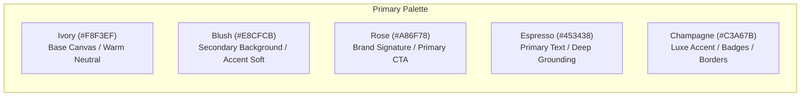

# The Nail Lounge — Brand & Design System Direction
**Document Version:** 1.0.0  
**Status:** Approved Blueprint for Phase 0  

---

## 1. Brand Identity & Personality

The Nail Lounge visual identity merges **editorial beauty aesthetics** (sophisticated, tactile, high-fashion) with **modern social commerce** (snappy, mobile-first, visual, frictionless).

### Brand Personality Attributes:
1. **Feminine & Expressive:** Soft, warm, romantic tones without feeling juvenile or dated.
2. **Confident & Contemporary:** Clean whitespace, crisp typographic pairings, and confident editorial photography.
3. **Accessible Premium:** Exudes the tactile luxury of a high-end salon while welcoming shoppers from all backgrounds with approachable pricing and warm copywriting.

---

## 2. Color System & Design Tokens

### 2.1 Color Token Mapping
| Token Name | Hex Code | RGB | Role & Usage | Contrast Ratio vs Background |
| :--- | :--- | :--- | :--- | :--- |
| `bg-canvas` | `#F8F3EF` | `248, 243, 239` | Global page background, card surfaces | — |
| `bg-surface-subtle` | `#F1E9E3` | `241, 233, 227` | Filter sidebars, table headers, pill tabs | 1.1:1 vs canvas |
| `color-blush` | `#E8CFCB` | `232, 207, 203` | Soft borders, subtle hover tints, badges | 1.3:1 vs canvas |
| `color-rose` | `#A86F78` | `168, 111, 120` | Primary buttons, active tabs, links, highlights | 4.8:1 vs canvas (WCAG AA) |
| `color-rose-dark` | `#8F5962` | `143, 89, 98` | Button hover/active states, focused borders | 6.2:1 vs canvas (WCAG AAA) |
| `color-espresso` | `#453438` | `69, 52, 56` | Primary body text, headings, dark buttons | 10.4:1 vs canvas (WCAG AAA) |
| `color-espresso-muted`| `#78656A` | `120, 101, 106` | Secondary labels, breadcrumbs, helper text | 5.2:1 vs canvas (WCAG AA) |
| `color-champagne` | `#C3A67B` | `195, 166, 123` | Premium badges, star ratings, metallic accents | 2.5:1 (decorative) |
| `status-success` | `#2D6A4F` | `45, 106, 79` | In-stock indicators, order confirmed | 5.5:1 vs canvas |
| `status-error` | `#BA1A1A` | `186, 26, 26` | Validation errors, out of stock alerts | 5.1:1 vs canvas |

---

## 3. Typography System

The typographic pairing balances artistic elegance with digital screen legibility:
- **Heading / Editorial Font:** `Cormorant Garamond` (Google Font: Serif, weights: 500 Medium, 600 Semi-Bold, 700 Bold, Italic).
- **Body / Interface Font:** `Manrope` (Google Font: Sans-Serif, weights: 400 Regular, 500 Medium, 600 Semi-Bold, 700 Bold).

### 3.1 Typographic Scale (Tailwind Compatible)
| Style Level | Font Family | Size (px / rem) | Line Height | Tracking | Weight | Semantic HTML |
| :--- | :--- | :--- | :--- | :--- | :--- | :--- |
| **Display 1** | Cormorant Garamond | `48px / 3.0rem` | `1.15` | `-0.02em` | Semi-Bold (600) | `h1` (Hero Editorial) |
| **Heading 1** | Cormorant Garamond | `36px / 2.25rem` | `1.2` | `-0.01em` | Semi-Bold (600) | `h1` (Page Title) |
| **Heading 2** | Cormorant Garamond | `28px / 1.75rem` | `1.25` | `normal` | Semi-Bold (600) | `h2` (Section Headers) |
| **Heading 3** | Cormorant Garamond | `22px / 1.375rem` | `1.3` | `normal` | Medium (500) | `h3` (Card Titles) |
| **Subheading**| Manrope | `18px / 1.125rem` | `1.4` | `+0.01em` | Medium (500) | `h4` / `p` |
| **Body Large**| Manrope | `16px / 1.0rem` | `1.6` | `normal` | Regular (400) | `p` (Editorial body) |
| **Body Base** | Manrope | `14px / 0.875rem` | `1.5` | `normal` | Regular (400) | `p` / `span` (Standard) |
| **Body Small**| Manrope | `12px / 0.75rem` | `1.4` | `+0.01em` | Medium (500) | `span` (Secondary meta)|
| **Overline** | Manrope | `11px / 0.687rem` | `1.2` | `+0.08em` | Bold (700) (UPPER) | `span` (Category badges)|

---

## 4. Spacing Scale & Layout Grid

### 4.1 8-Point Spatial Grid
- Base grid unit: `8px`. Micro-spacing unit: `4px`.
- Tailwind spatial scale:
  - `space-1`: `4px` (Micro-gaps, badge padding)
  - `space-2`: `8px` (Icon gaps, input inner margins)
  - `space-3`: `12px` (Card inner padding - compact)
  - `space-4`: `16px` (Card inner padding - standard mobile)
  - `space-6`: `24px` (Section gutters, grid spacing)
  - `space-8`: `32px` (Card margins, desktop gutters)
  - `space-12`: `48px` (Sub-section vertical spacing)
  - `space-16`: `64px` (Major section vertical spacing)
  - `space-24`: `96px` (Hero section vertical margins)

### 4.2 Breakpoints (Tailwind Standards)
- `sm`: `640px` (Large phones / small tablets)
- `md`: `768px` (Tablets / small laptops)
- `lg`: `1024px` (Desktops / catalog 3-4 col grids)
- `xl`: `1280px` (Max container width, 12-col centered grid)
- `2xl`: `1536px` (Wide displays)

---

## 5. UI Component Specifications

### 5.1 Buttons
- **Primary CTA:**
  - Background: `color-rose` (`#A86F78`), Text: `#FFFFFF`, Font: `Manrope Semi-Bold 14px`, Border-radius: `6px` (soft architectural radius).
  - Hover: `color-rose-dark` (`#8F5962`), Transition: `150ms ease-out`.
  - Height: `48px` on mobile (thumb-friendly tap target), `44px` on desktop.
- **Secondary / Outline CTA:**
  - Background: `transparent`, Border: `1px solid #453438` (Espresso), Text: `#453438`.
  - Hover: Background `#453438`, Text: `#FFFFFF`.
- **Express Buy CTA ("Buy Now"):**
  - Background: `color-espresso` (`#453438`), Text: `#F8F3EF`.
- **Mobile Persistent Bottom Bar:**
  - Fixed at `bottom: 0`, full width, background: `rgba(248, 243, 239, 0.95)` with backdrop blur `8px`, top border: `1px solid #E8CFCB`. Height: `64px`.

### 5.2 Product Cards
- Aspect Ratio: `4:5` (optimal for fashion and manicure vertical hand framing).
- Structure:
  - Image container with subtle rounded corners (`rounded-lg`), overflow hidden.
  - Hover state (Desktop): Smooth cross-fade to second lifestyle image (`transition-opacity duration-300`).
  - Top Left Badge: Shape & Length badge (`Almond • Med`) or Status badge (`Bestseller`).
  - Top Right: Guest Wishlist Heart toggle icon button.
  - Bottom Bar (Desktop): Hover slide-up "Quick Add +" button.
  - Text area: Product title in `Cormorant Garamond 16px`, Price in `Manrope Semi-Bold 14px` with strike-through MRP.

### 5.3 Badges & Chips
- **Universal Fit Badge:** Background: `#E8CFCB`, Text: `#453438`, Label: "Universal Fit (24 Pcs)".
- **Handcrafted Badge:** Border: `1px solid #C3A67B`, Text: `#C3A67B`, Label: "Studio Artisan".
- **Low Stock Badge:** Background: `#FEE2E2`, Text: `#BA1A1A`, Label: "Only 2 left".

### 5.4 Form Elements
- Inputs have floating labels or clear top labels in `Manrope 12px Medium`.
- Background: `#FFFFFF`, Border: `1px solid #E8CFCB`, Border Radius: `6px`, Height: `44px`.
- Focus state: Border: `1.5px solid #A86F78`, Outline: `none`, Ring: `2px rgba(168, 111, 120, 0.2)`.
- Error state: Border: `1.5px solid #BA1A1A`, error text below input in `12px #BA1A1A`.

### 5.5 Drawers & Modals
- **Cart Drawer:**
  - Enters from right edge on desktop (Width: `420px`), slides up from bottom on mobile (Height: `85vh`).
  - Backdrop: `rgba(69, 52, 56, 0.5)` with background blur `4px`.
  - Content header: Fixed title + Free Shipping Bar. Body: Scrollable items. Footer: Subtotal + Checkout CTA.
- **Sizing Guide Modal:**
  - Centered dialog on desktop (Max-width: `560px`), full-screen bottom sheet on mobile.

### 5.6 Micro-States & Feedback
- **Skeleton Shimmers:** Soft ivory-to-blush linear gradient animation (`background: linear-gradient(90deg, #F1E9E3 25%, #E8CFCB 50%, #F1E9E3 75%)`).
- **Toasts:** Floating snackbars anchored top-right (desktop) or top-center (mobile) for notifications ("Added to Bag", "Link Copied").
- **Empty States:** Clean editorial iconography, friendly headline, and clear recovery CTA (e.g., "Your shopping bag is empty -> Explore Bestsellers").

