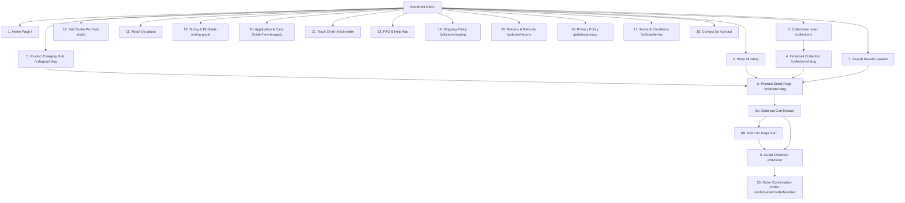

# The Nail Lounge — Information Architecture (IA)
**Document Version:** 1.0.0  
**Status:** Approved Blueprint for Phase 0  

---

## 1. Global Sitemap & Hierarchy

---

## 2. Comprehensive Page-by-Page Specifications

### Page 1: Home (`/`)
- **Purpose:** Serve as the brand's editorial flagship; introduce brand positioning ("Artistry at Your Fingertips"), establish trust, and direct visitors into high-intent shopping funnels.
- **Target Visitor Intent:** Casual browsing, discovering trends, evaluating brand credibility, seeking instant inspiration.
- **Required Sections:**
  1. Top Utility Bar (Free delivery above ₹999, Abohar Studio Dispatch).
  2. Main Header & Navigation (Logo, Shop, Collections, Nail Studio, Sizing, Search, Cart Trigger).
  3. Hero Editorial Section (High-impact visual banner, tagline, value proposition).
  4. Quick Filter Category Pills (All, Press-on Nails, Gel Polish, Nail Art, Tools, Kits).
  5. Curated Spotlight Collection (e.g., "The Bridal & Festive Edit").
  6. Value Proposition Strip (Salon Quality 15-Min Application, Reusable up to 3x, Safe on Natural Nails, Hand-finished in India).
  7. Trending Now Grid (Curated high-converting products with quick-add).
  8. Interactive "Find Your Fit" teaser banner linking to Sizing Guide.
  9. Editorial Story / Studio Abohar Heritage snippet.
  10. Instagram / Social Visual Wall (Real customer manicures).
  11. Footer with complete links, newsletter capture, and trust badges.
- **Primary CTA:** "Explore Collection" / "Shop New Arrivals"
- **Secondary CTA:** "Find Your Nail Size"
- **Navigation Entry Points:** Domain root, logo clicks, external social campaign landers.
- **Related Pages:** `/collections`, `/shop`, `/sizing-guide`, `/about`.
- **Conversion Opportunities:** Direct "Quick Add" to cart from product grids, visual occasion banners.
- **States:**
  - *Loading:* Hero skeleton shimmer, 4-card product grid skeleton placeholders.
  - *Error:* Graceful fallback with static editorial hero and top category links.

---

### Page 2: Shop All / Catalog (`/shop`)
- **Purpose:** Centralized, comprehensive catalog allowing shoppers to browse the entire inventory with granular faceted filtering and sorting.
- **Target Visitor Intent:** Intentional browsing, exploring broad selection, filtering by specific preferences.
- **Required Sections:**
  1. Page Header (Title, Total Product Count, Breadcrumbs).
  2. Sticky Filter & Sort Bar (Sort by: Featured, Price Low-High, Price High-Low, Newest).
  3. Desktop Sidebar / Mobile Bottom Sheet Filters:
     - Category (Press-on, Gel, Art, Tools, Kits)
     - Nail Shape (Almond, Coffin, Square, Oval, Stiletto)
     - Nail Length (Short, Medium, Long)
     - Finish (Glossy, Matte, Chrome/Glazed, Cat Eye, 3D/Embossed)
     - Color Family (Nude, Red/Berry, Pastel, Black/Dark, Metallic)
     - Price Range Slider
  4. Active Filter Tags with "Clear All" button.
  5. Responsive Product Grid (4 columns desktop, 2 columns mobile).
  6. Pagination / "Load More" button with progress indicator ("Showing 24 of 86 products").
- **Primary CTA:** "Add to Bag" on individual product cards.
- **Secondary CTA:** "Filter & Sort" trigger button (mobile).
- **Navigation Entry Points:** Main header "Shop" link, footer catalog link.
- **Related Pages:** `/products/:slug`, `/collections`, `/category/:slug`.
- **Conversion Opportunities:** Visual finish swatches on cards, shape badges, real-time inventory counters.
- **States:**
  - *Loading:* Grid of 8 animated shimmer product card skeletons.
  - *Empty State:* "No styles match your filters" with clear filter button and "View Bestsellers" CTA.
  - *Error:* Retry button with friendly message.

---

### Page 3: Collections Index (`/collections`)
- **Purpose:** High-level editorial directory showcasing curated thematic collections (e.g., Bridal, Everyday Minimal, Festive Glam, French Reimagined).
- **Target Visitor Intent:** Mood-based exploration, seeking looks for a specific occasion or personal aesthetic.
- **Required Sections:**
  1. Editorial Header ("Curated Edits & Lookbooks").
  2. Featured Hero Collection Banner (e.g., "The Royal Festive Collection").
  3. Masonry/Grid of Collection Cards (High-resolution lifestyle cover, title, description, piece count).
  4. Occasion Quick Navigator (Weddings, Date Night, Daily Chic, Holiday).
- **Primary CTA:** "View Collection"
- **Secondary CTA:** "Shop All Nails"
- **Navigation Entry Points:** Header navigation dropdown, homepage feature tiles.
- **Related Pages:** `/collections/:slug`, `/shop`.
- **Conversion Opportunities:** Thematic bundling suggestions, pre-styled look inspirations.
- **States:**
  - *Loading:* 4-block banner skeleton cards.
  - *Empty:* Fallback to category browsing.

---

### Page 4: Individual Collection Page (`/collections/:slug`)
- **Purpose:** Curated, thematic micro-catalog telling a coherent visual story around a single theme.
- **Target Visitor Intent:** Buying an entire look or browsing a focused aesthetic.
- **Required Sections:**
  1. Collection Hero Banner (Editorial image, narrative paragraph, curated styling tips).
  2. Dedicated Collection Product Grid.
  3. Thematic Filter Pills (sub-styles within the collection).
  4. Merchandised Bundle Callout (e.g., "Buy any 2 sets from this collection & get a free application kit").
- **Primary CTA:** "Add to Bag" / "Quick View"
- **Secondary CTA:** "Back to All Collections"
- **Navigation Entry Points:** `/collections`, homepage banner carousels, marketing ad campaigns.
- **Related Pages:** `/products/:slug`, `/collections`.
- **Conversion Opportunities:** Cross-product styling pairings, limited-edition seasonal banners.
- **States:**
  - *Loading:* Header shimmer and 4-product grid skeleton.
  - *Empty:* "This seasonal edit has concluded. Discover our permanent classics."

---

### Page 5: Product Category Page (`/category/:slug`)
- **Purpose:** Category-specific landing page tailored to specific product lines (e.g., `/category/press-on-nails`, `/category/nail-art-accessories`, `/category/tools`).
- **Target Visitor Intent:** Category-focused shopper (e.g., searching specifically for nail art tools or gel polish).
- **Required Sections:**
  1. Category Title, Description & Hero Vignette.
  2. Category-Specific Sub-Categories (e.g., within Nail Art: Charms, Foil, Chrome Powder, Decals).
  3. Category-Tailored Filter Facets.
  4. Filtered Product Grid.
  5. Category Educational Snippet (e.g., "How to choose between adhesive tabs vs nail glue").
- **Primary CTA:** "Add to Bag"
- **Secondary CTA:** "Filter by Shape / Finish"
- **Navigation Entry Points:** Main header navigation, footer links, search suggestions.
- **Related Pages:** `/shop`, `/products/:slug`, `/how-to-apply`.
- **Conversion Opportunities:** Category-specific bundled starter kits displayed at top of grid.
- **States:**
  - *Loading:* Category banner shimmer + product skeletons.
  - *Empty:* "Currently restocking this category. Browse our Press-on Collection."

---

### Page 6: Product Detail Page (PDP) (`/products/:slug`)
- **Purpose:** The primary conversion engine; provides comprehensive product imagery, sizing guidance, specifications, and trust signals to eliminate purchase hesitation.
- **Target Visitor Intent:** High-intent evaluation; verifying fit, quality, durability, and contents before buying.
- **Required Sections:**
  1. Breadcrumbs (`Home > Press-on Nails > Royal Almond Chrome`).
  2. Image Gallery (Desktop: 2-column sticky gallery / Mobile: horizontal swipe carousel with indicators; includes hand model shots, nail shape guide, package unboxing shot).
  3. Product Title, Category, and SKU.
  4. Pricing Display: Selling Price, MRP (crossed out), Calculated Discount Percentage, "Inclusive of all taxes".
  5. Set Type Selector:
     - **Universal Set (24 Nails):** "Recommended for beginners — guaranteed fit for all finger sizes, no measuring required."
     - **Custom Sized Set (10 Nails):** Sizing chips (XS, S, M, L) + "Sizing Guide & Measurement" interactive modal trigger.
  6. Shape & Length Specification Badges (e.g., Shape: Medium Almond).
  7. Finish & Color Swatches.
  8. Stock Status Alert (e.g., "In Stock" or "Only 3 left in Medium Almond").
  9. Quantity Selector & Primary "Add to Bag" Button (Sticky at bottom on mobile screens).
  10. "Buy Now" Express Checkout Button.
  11. Indian Pincode Delivery Checker (Instant estimated delivery window, e.g., "Delivered by Thursday, 12th Nov").
  12. "What's Inside the Box" Accordion (List of contents: nails, glue, tabs, buffer, stick, prep pad).
  13. "How to Apply in 4 Steps" Accordion (with mini diagrams).
  14. "Safe, Damage-Free Removal" Accordion.
  15. Materials & Compliance Accordion (ABS plastic, UV gel coat, non-toxic, country of origin: India).
  16. "Complete Your Look" / Frequently Bought Together Pairings (e.g., Extra Glue Tabs + Cuticle Oil).
  17. Customer Reviews Section (Verified purchases only; empty state invitation for early buyers).
  18. Related Products Carousel.
- **Primary CTA:** "Add to Bag"
- **Secondary CTA:** "Buy Now" (Direct to Checkout)
- **Navigation Entry Points:** All catalog grids, search results, marketing ads, social bio links.
- **Related Pages:** `/sizing-guide`, `/how-to-apply`, `/cart`, `/checkout`.
- **Conversion Opportunities:** Universal 24-piece default selection eliminates sizing friction; sticky mobile add-to-bag bar maintains constant conversion opportunity.
- **States:**
  - *Loading:* Two-column skeleton layout.
  - *Out of Stock:* "Sold Out" button with "Notify Me on WhatsApp/Email" input.
  - *Error:* "Product not found. Explore trending styles."

---

### Page 7: Search Results (`/search`)
- **Purpose:** Rapidly connect visitors searching by keyword to relevant products, handling typos and zero-result situations gracefully.
- **Target Visitor Intent:** Intentional, focused product discovery.
- **Required Sections:**
  1. Search Header with query reflection ("Results for 'french almond' - 14 items found").
  2. Search Refinement Bar (Quick filters: Category, Price, Shape).
  3. Product Grid of matches.
  4. Zero-Result State (If no matches: "We couldn't find any styles matching your search", followed by Popular Search Chips: "Bridal", "Short Square", "Chrome Glazed", and a Curated Recommendations Grid).
- **Primary CTA:** "Add to Bag"
- **Secondary CTA:** "Clear Search"
- **Navigation Entry Points:** Header search icon, mobile search bar.
- **Related Pages:** `/shop`, `/products/:slug`.
- **Conversion Opportunities:** Instant search preview dropdown showing top 4 matches before page submit.
- **States:**
  - *Loading:* Search shimmer cards.
  - *Zero Results:* Smart fallback to popular collections.

---

### Page 8A: Slide-out Cart Drawer (Mini-Cart)
- **Purpose:** Immediate visual feedback when an item is added to the cart, enabling quick quantity adjustments and frictionless transition to checkout without leaving the browsing context.
- **Target Visitor Intent:** Reviewing added items, checking order total, progressing to checkout.
- **Required Sections:**
  1. Drawer Header (Cart title, item count, close 'X' button).
  2. Free Shipping Threshold Progress Meter ("Add ₹240 more for Free Express Delivery!").
  3. Scrollable Cart Item List (Image thumbnail, title, selected size/shape variant, unit price, quantity increment/decrement controls, remove button).
  4. In-Cart Upsell Carousel / Quick Add (e.g., "Add Nail Dehydrator Wipes for ₹79").
  5. Order Summary (Subtotal, estimated shipping disclaimer).
  6. Primary Checkout Button (Displaying subtotal: "Proceed to Checkout — ₹1,299").
  7. Secondary "View Full Bag" link.
  8. Trust & Security Badges (100% Secure Checkout, Easy Damage Replacement).
- **Primary CTA:** "Proceed to Checkout"
- **Secondary CTA:** "Continue Shopping" / "View Full Cart"
- **Navigation Entry Points:** Automatic slide-in on "Add to Bag", header cart icon click.
- **Related Pages:** `/checkout`, `/cart`.
- **Conversion Opportunities:** High-margin 1-click add-ons, free shipping progress bar.
- **States:**
  - *Empty State:* "Your shopping bag is empty" with an inspiring editorial photo and "Explore Bestsellers" CTA.

---

### Page 8B: Full Cart Page (`/cart`)
- **Purpose:** Dedicated full-screen review page for shoppers who prefer a comprehensive breakdown of their order before committing to checkout.
- **Target Visitor Intent:** Comprehensive order review, applying discount coupon codes, modifying bulk quantities.
- **Required Sections:**
  1. Breadcrumbs & Order Progress Stepper (`1. Bag > 2. Delivery > 3. Confirmation`).
  2. 2-Column Desktop Layout (Left: Detailed Item Table; Right: Order Summary Card).
  3. Item Table (Item photo, details, unit price, quantity controls, line total, remove).
  4. Coupon Code / Promo Input Box with "Apply" button.
  5. Order Summary Box (Subtotal, Coupon Discount, Estimated Shipping, Estimated Total).
  6. Customer Satisfaction & Hygiene Assurance Note.
- **Primary CTA:** "Proceed to Checkout"
- **Secondary CTA:** "Continue Shopping"
- **Navigation Entry Points:** Cart drawer link, direct URL `/cart`.
- **Related Pages:** `/checkout`, `/shop`.
- **Conversion Opportunities:** Upsell recommendations beneath item table.
- **States:**
  - *Empty State:* Clean graphic with link to `/shop`.

---

### Page 9: Guest Checkout (`/checkout`)
- **Purpose:** Complete the purchase transaction with maximum speed and zero friction; no mandatory registration or password creation.
- **Target Visitor Intent:** Finalizing purchase, entering delivery details, selecting payment method.
- **Required Sections:**
  1. Minimal Distraction-Free Header (Logo only, SSL secure badge, "Return to Cart" link).
  2. 2-Step Accordion Form:
     - **Step 1: Contact & Delivery Address:**
       - Email address (for digital invoice and order confirmation).
       - WhatsApp / Mobile phone number (for dispatch updates).
       - Full Name.
       - Flat / House No / Building / Street address.
       - 6-digit Indian Pincode (Triggers auto-fill for City and State).
       - City & State (pre-populated, editable).
       - Landmark (optional).
     - **Step 2: Shipping & Payment Method:**
       - Delivery speed selection (Standard Delivery 3-5 days vs Express Courier 2 days).
       - Payment Method Selection:
         - Cash on Delivery (COD) / Manual Order Verification.
         - Instant UPI / Card / Netbanking (Phase 5 integration placeholder; mock mode for MVP testing).
  3. Order Summary Sidebar (Item previews, subtotal, shipping cost, total payable).
  4. Final "Place Order" CTA with clear terms acknowledgement.
- **Primary CTA:** "Place Order (₹1,499)"
- **Secondary CTA:** "Back to Shopping Bag"
- **Navigation Entry Points:** Cart drawer, full cart page.
- **Related Pages:** `/order-confirmation/:orderNumber`, `/policies/shipping`.
- **Conversion Opportunities:** Pincode auto-lookup reduces mobile typing fatigue by 40%; guest checkout eliminates login drop-off.
- **States:**
  - *Loading:* Spinner on form submission with disabled buttons to prevent double-charging.
  - *Error:* Inline validation errors highlighted under specific fields (e.g., "Enter a valid 6-digit pincode").

---

### Page 10: Order Confirmation (`/order-confirmation/:orderNumber`)
- **Purpose:** Reassure the customer, confirm order receipt, provide transparent fulfillment expectations, and reinforce post-purchase confidence.
- **Target Visitor Intent:** Reviewing receipt, saving order details, understanding delivery timeline.
- **Required Sections:**
  1. Celebration Header ("Thank you, [Name]! Your order has been placed.").
  2. Order Reference Number (e.g., `#TNL-2026-8812`) and placement timestamp.
  3. Estimated Delivery Date Window.
  4. Delivery Address Summary & Contact Info.
  5. Ordered Items List with variants and prices paid.
  6. "Track Your Order" Button.
  7. Post-Purchase Value Add:
     - "Download Application & Care Guide (PDF)"
     - "Join our VIP WhatsApp Club for exclusive styling drops"
  8. Customer Support Contact Link (WhatsApp click-to-chat with pre-filled order number).
- **Primary CTA:** "Track Order Status"
- **Secondary CTA:** "Continue Shopping" / "Download Nail Care Guide"
- **Navigation Entry Points:** Successful checkout redirect only.
- **Related Pages:** `/track-order`, `/how-to-apply`, `/shop`.
- **Conversion Opportunities:** Secondary purchase promo code for their next order (e.g., "Use code REPEATGLAM for 10% off your next set").
- **States:**
  - *Error:* If order ID is invalid, display order lookup search box.

---

### Page 11: About Us (`/about`)
- **Purpose:** Build emotional connection, brand trust, and articulate the brand story—grounded in Abohar, Punjab—and the mission to democratize luxury nail artistry.
- **Target Visitor Intent:** Evaluating brand authenticity, understanding who makes the nails, learning about quality standards.
- **Required Sections:**
  1. Editorial Brand Manifesto ("Artistry at Your Fingertips").
  2. The Abohar Studio Story (The journey of local artistry, attention to detail, handcrafted excellence).
  3. Our Quality Philosophy (Salon-grade ABS material, 5-layer gel finishing, non-damaging application).
  4. Sustainability & Reusability Commitment (Why press-on nails are better for natural nail health).
  5. Meet the Artisans / Behind the Scenes imagery.
- **Primary CTA:** "Explore Our Handcrafted Sets"
- **Secondary CTA:** "Read Our FAQ"
- **Navigation Entry Points:** Header navigation, footer links.
- **Related Pages:** `/shop`, `/collections`, `/contact`.
- **Conversion Opportunities:** Curated "Founder's Favorite Sets" collection embedded directly in the story.

---

### Page 12: Nail Studio / Professional Shopping (`/nail-studio`)
- **Purpose:** Serve the B2B and professional audience (nail technicians, freelance artists, salon owners) seeking bulk orders, professional-grade supplies, and studio kits.
- **Target Visitor Intent:** Commercial bulk purchasing, professional tools inquiry, salon kit sourcing.
- **Required Sections:**
  1. Professional Hero Banner ("Elevate Your Nail Artistry — Salon Supplies & Pro Kits").
  2. Pro Categories (Bulk Press-on Blanks, Pro UV Curing Lamps, High-Pigment Gels, Precision Brushes, Display Stands).
  3. Bulk Tier Pricing & Salon Starter Packages.
  4. B2B Inquiry / Wholesale Contact Form (Business name, GSTIN optional, city, requirements).
  5. Direct WhatsApp Trade Concierge button.
- **Primary CTA:** "Inquire for Salon Wholesale"
- **Secondary CTA:** "Shop Professional Tools"
- **Navigation Entry Points:** Main header navigation, footer "For Professionals" link.
- **Related Pages:** `/category/tools`, `/contact`.
- **Conversion Opportunities:** High-value B2B inquiries and recurring bulk orders.

---

### Page 13: FAQ & Help Center (`/faq`)
- **Purpose:** Address objections and answer common questions regarding sizing, durability, water resistance, application, and shipping.
- **Target Visitor Intent:** Seeking answers to resolve pre-purchase hesitation or post-purchase care questions.
- **Required Sections:**
  1. Search Help Bar.
  2. Categorized FAQ Accordions:
     - Sizing & Fit (How to measure, what if my nails are between sizes?)
     - Wear & Durability (How long do they last? Can I shower/wash dishes?)
     - Application & Removal (Adhesive tabs vs nail glue; how to remove without damage)
     - Shipping & Delivery (Delivery times to Tier 2/3 cities, tracking)
     - Orders & Returns (Damaged item policy, return rules)
  3. "Still have questions?" Contact Box with direct WhatsApp support button.
- **Primary CTA:** "Chat on WhatsApp"
- **Secondary CTA:** "View Sizing Guide"
- **Navigation Entry Points:** Footer, PDP accordion links, header utility bar.
- **Related Pages:** `/sizing-guide`, `/how-to-apply`, `/contact`.

---

### Page 14: Shipping and Delivery Policy (`/policies/shipping`)
- **Purpose:** Set clear legal and operational expectations for shipping timelines, courier partners, serviceable Indian pincodes, and shipping fees.
- **Target Visitor Intent:** Checking if delivery reaches their town and how many days it will take.
- **Required Sections:**
  1. Dispatch timelines (Orders dispatched within 24–48 hours from Abohar studio).
  2. Standard vs Express Delivery timelines (Punjab/North India: 2-3 days; Rest of India: 4-6 business days).
  3. Shipping fees and Free Shipping threshold (Free shipping on orders above ₹999).
  4. Courier partners (Delhivery, Bluedart, Xpressbees, India Post for remote pincodes).
  5. Tracking number notifications.
- **Primary CTA:** "Start Shopping"
- **Secondary CTA:** "Track Existing Order"
- **Navigation Entry Points:** Footer, PDP shipping accordion, checkout page footer.

---

### Page 15: Returns and Refund Policy (`/policies/returns`)
- **Purpose:** Clearly state policies compliant with Indian consumer protection standards while safeguarding product hygiene.
- **Target Visitor Intent:** Understanding return rights before ordering; requesting support for transit-damaged items.
- **Required Sections:**
  1. Hygiene Disclaimer: Press-on nails and cosmetic products cannot be returned once unsealed/used for personal hygiene reasons.
  2. 48-Hour Transit Damage Guarantee: If items arrive damaged or incorrect, customers receive a free replacement or full refund upon submitting an unboxing photo/video within 48 hours.
  3. Step-by-step claims process via WhatsApp/Email.
  4. Refund processing timelines (3-5 business days to original payment method).
- **Primary CTA:** "Contact Support for Replacement"
- **Secondary CTA:** "Back to Store"
- **Navigation Entry Points:** Footer, PDP, checkout footer.

---

### Page 16: Privacy Policy (`/policies/privacy`)
- **Purpose:** Legal compliance under the Indian Digital Personal Data Protection (DPDP) Act, 2023.
- **Target Visitor Intent:** Verifying data safety, understanding cookie usage and marketing communications.
- **Required Sections:**
  1. Data collected (Name, phone number, shipping address, email, IP address).
  2. Purpose of collection (Order fulfillment, delivery tracking, statutory tax compliance).
  3. Third-party data sharing (Logistics partners, payment gateways only).
  4. Customer rights (Access, correction, deletion).
  5. Grievance Officer details (Mandatory under Indian e-commerce rules: Name, email, Abohar address).
- **Navigation Entry Points:** Footer, checkout agreement snippet.

---

### Page 17: Terms and Conditions (`/policies/terms`)
- **Purpose:** Enforceable contract governing storefront usage, product pricing, intellectual property, and jurisdictional disputes.
- **Target Visitor Intent:** Formal contractual reference.
- **Required Sections:**
  1. Acceptance of terms.
  2. Product descriptions and pricing accuracy (Protection against typographical pricing errors).
  3. Order acceptance and cancellation rights.
  4. Intellectual property (Brand photography, logo, proprietary designs).
  5. Governing Law & Jurisdiction (Courts of Abohar / Fazilka District, Punjab).
- **Navigation Entry Points:** Footer, checkout footer.

---

### Page 18: Contact Us (`/contact`)
- **Purpose:** Multi-channel customer service portal establishing approachable, verified brand contact points.
- **Target Visitor Intent:** Seeking pre-purchase advice, bulk order quotes, or order support.
- **Required Sections:**
  1. Direct Contact Channels:
     - WhatsApp Business Instant Support (One-click chat button).
     - Customer Care Email.
     - Customer Care Phone Support hours (10:00 AM – 7:00 PM IST).
  2. Physical Studio Address (The Nail Lounge Studio, Abohar, Punjab - 152116).
  3. Interactive Contact Form (Name, Phone, Order ID optional, Message).
  4. Social Media Handles (@thenaillounge.in).
- **Primary CTA:** "Send Message"
- **Secondary CTA:** "Chat on WhatsApp"
- **Navigation Entry Points:** Header navigation, footer.
- **Related Pages:** `/faq`, `/about`.

---

### Page 19 (Recommended): Sizing & Fit Guide (`/sizing-guide`)
- **Purpose:** Eliminate the #1 conversion barrier for press-on nails (sizing uncertainty) by providing foolproof self-measurement guides and printable sizing rulers.
- **Target Visitor Intent:** Determining their exact nail size (XS, S, M, L) before purchasing a custom 10-piece set.
- **Required Sections:**
  1. Visual Measurement Tutorial: "How to Measure Your Nails in 2 Minutes" using household clear tape and a millimeter ruler.
  2. Interactive Size Calculator: User inputs millimeter widths for Thumb, Index, Middle, Ring, Pinky -> System outputs recommended size (e.g., "Size Small").
  3. Standard Size Chart Matrix:
     - Extra Small (XS): 14mm, 10mm, 11mm, 10mm, 7mm
     - Small (S): 15mm, 11mm, 12mm, 11mm, 8mm
     - Medium (M): 16mm, 12mm, 13mm, 12mm, 9mm
     - Large (L): 18mm, 13mm, 14mm, 13mm, 10mm
  4. The "No-Measure Solution": Feature the **Universal 24-Piece Set** (includes all 12 finger sizes x 2 nails each; guaranteed to fit every hand with zero measuring).
  5. Printable Paper Sizing Ruler (Downloadable PDF).
- **Primary CTA:** "Shop Universal 24-Piece Sets (Zero Measuring)"
- **Secondary CTA:** "Shop by Custom Size"
- **Navigation Entry Points:** Header navigation, PDP sizing modal, footer.
- **Related Pages:** `/products/:slug`, `/faq`.
- **Conversion Impact:** Reduces size-related return requests by >85% and eliminates abandoned carts on PDPs.

---

### Page 20 (Recommended): How-To Application & Care Guide (`/how-to-apply`)
- **Purpose:** Overcome durability skepticism by teaching correct preparation, application methods (adhesive tabs vs liquid glue), and damage-free removal.
- **Target Visitor Intent:** Learning how to apply press-on nails for 2-day weekend wear vs 2-3 week long wear.
- **Required Sections:**
  1. Tab vs Glue Comparison Guide (Adhesive Tabs: 2-4 days wear, reusable nails; Liquid Glue: 2-3 weeks wear, maximum hold).
  2. Step-by-Step Application Guide:
     - Step 1: Prep & Push cuticles.
     - Step 2: Buff natural nail surface gently to remove natural oils.
     - Step 3: Dehydrate with alcohol prep pad.
     - Step 4: Apply adhesive at 45-degree angle and hold firmly for 30 seconds.
  3. Video/GIF Demonstration clips.
  4. Safe Removal Guide (Soaking in warm soapy water with cuticle oil for 10 minutes — never pull or rip off).
  5. Reusability & Cleaning Tips for press-on tips.
- **Primary CTA:** "Shop Application & Prep Kits"
- **Secondary CTA:** "Browse Nail Styles"
- **Navigation Entry Points:** Header, PDP application accordion, order confirmation page.

---

### Page 21 (Recommended): Track Order Lookup (`/track-order`)
- **Purpose:** Self-service tracking portal allowing guest shoppers to look up real-time shipping status without needing an account.
- **Target Visitor Intent:** Checking parcel transit progress.
- **Required Sections:**
  1. Tracking Form (Input: Order Number e.g. `TNL-1042` + Phone Number or Email).
  2. Live Status Timeline (Order Confirmed > Handcrafted & Packed > Dispatched from Abohar > In Transit > Out for Delivery > Delivered).
  3. Courier Partner Name and Tracking AWB link.
  4. "Need help with delivery?" WhatsApp support button.
- **Primary CTA:** "Track Parcel"
- **Secondary CTA:** "Contact Courier Support"
- **Navigation Entry Points:** Top utility bar, footer, order confirmation email/SMS.

