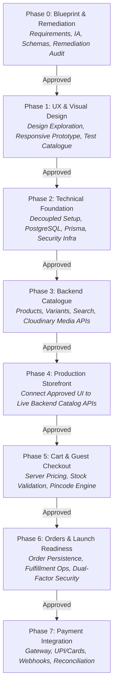

# The Nail Lounge — Engineering Roadmap (Phases 0 to 7)
**Document Version:** 2.0.0  
**Status:** Approved Roadmap Sequence (Updated Post-Phase 0 Audit)  

---

## 1. Roadmap Architecture & Phased Sequence

The engineering and product lifecycle for **The Nail Lounge** is structured into 8 distinct sequential phases. No phase may begin without explicit sign-off on the deliverables and test criteria of the preceding phase.

---

## 2. Detailed Phase Breakdown

### Phase 0: Blueprint, Architecture & Remediation (COMPLETE)
- **Objective:** Establish the foundational product, UX, architectural, and database blueprint, and remediate all premature marketing claims or unsubstantiated assumptions.
- **Key Deliverables:**
  - Complete 12-file architecture documentation package in `/docs`.
  - Issue Register & Audit Report (`PHASE_0_AUDIT_AND_CORRECTIONS.md`).
  - Extensible database schema, API contracts, and security token models.
  - Comprehensive open questions register for business resolution.
- **Phase Gate:** Audit and remediation approved; approval to proceed to Phase 1 UX prototyping.

---

### Phase 1: UX & Visual Design (CURRENT PHASE)
- **Objective:** Create a high-quality, responsive, inspectable visual prototype of the proposed storefront using Next.js App Router, TypeScript, and Tailwind CSS with realistic development fixtures.
- **Scope Boundaries:**
  - **In Scope:** Visual design exploration (Editorial vs Modern Commerce), responsive prototype for core pages (Home, Shop All, PDP, Cart Drawer, Guest Checkout), deterministic 36-product test catalogue, mock catalogue adapter, accessibility testing, customer journey verification.
  - **Strictly Out of Scope:** Database setup, Prisma migrations, live Express APIs, live payment gateways, real order persistence, customer authentication.
- **Key Deliverables:**
  - `docs/PHASE_1_UX_STRATEGY.md`
  - `docs/PHASE_1_VISUAL_DIRECTIONS.md`
  - `docs/PHASE_1_RESPONSIVE_SPECIFICATIONS.md`
  - `docs/PHASE_1_COMPONENT_INVENTORY.md`
  - `docs/PHASE_1_ACCEPTANCE_CRITERIA.md`
  - `docs/TEST_CATALOGUE_SPECIFICATION.md`
  - `docs/REAL_CATALOGUE_IMPORT_PLAN.md`
  - `docs/PHASE_1_TEST_REPORT.md`
  - Functional, responsive frontend prototype in `frontend/`.
- **Phase Gate:** Formal review and human approval of visual design and interactive prototype.

---

### Phase 2: Technical Foundation & Decoupled Infrastructure
- **Objective:** Initialize the independent backend application, PostgreSQL database, Prisma ORM, and environment configuration.
- **Key Deliverables:**
  - Independent Node.js + Express.js backend project structure.
  - PostgreSQL database connection and Prisma client singleton.
  - Execution of initial Prisma migrations establishing core tables (`categories`, `products`, `product_variants`, `product_options`, `product_images`, `product_inventories`).
  - Express middleware setup: Helmet security headers, rate limiters, Zod validation, centralized error handling.
  - Zero Prisma imports in frontend; verify decoupling.
- **Phase Gate:** Automated health check and migration tests passing.

---

### Phase 3: Backend Catalogue & Media Management
- **Objective:** Implement production-grade REST APIs for product catalog, categories, collections, search, and Cloudinary media signatures.
- **Key Deliverables:**
  - Modular Monolith backend modules: `products`, `categories`, `collections`, `search`, `media`.
  - Authenticated Cloudinary signature generation endpoint for administrative media uploads.
  - Faceted search and filtering query engine (Shape, Length, Finish, Price, Category).
  - Deterministic database seed script importing the verified catalog.
  - Integration tests verifying catalog endpoints and edge cases.
- **Phase Gate:** API contracts verified against Swagger/Postman test suite.

---

### Phase 4: Production Storefront Integration
- **Objective:** Wire the approved Next.js frontend prototype components to the live Express backend catalogue APIs.
- **Key Deliverables:**
  - Production `apiClient.ts` communicating with Express backend over REST/JSON.
  - Replacement of frontend mock adapter with live API calls.
  - Server-Side Rendering (SSR) and Incremental Static Regeneration (ISR) for high-speed SEO product pages.
  - Cloudinary dynamic image optimization (`f_auto`, `q_auto`, responsive `srcset`).
  - Core Web Vitals audit (LCP < 1.8s, CLS < 0.05).
- **Phase Gate:** End-to-end catalog browsing, search, and PDP rendering with live backend data.

---

### Phase 5: Cart Engine & Guest Checkout Orchestration
- **Objective:** Implement server-side cart synchronization, inventory stock validation, Indian Pincode serviceability, and checkout orchestration.
- **Key Deliverables:**
  - Backend `cart` and `checkout` modules.
  - Server-side price recalculation and coupon validation (preventing client-side price tampering).
  - 15-minute TTL inventory reservation during checkout initiation.
  - Indian 6-digit Pincode validation and city/state auto-population.
  - Shipping rate engine supporting dynamic free shipping thresholds.
- **Phase Gate:** Cart and checkout validation tests passing under simulated concurrency.

---

### Phase 6: Order Persistence & Launch Readiness
- **Objective:** Build immutable order persistence in PostgreSQL, operational fulfillment workflows, and security verification.
- **Key Deliverables:**
  - Backend `orders` and `customers` modules.
  - Immutable order snapshotting (`OrderItem` price/tax/title snapshots, `Order` address snapshot).
  - Cryptographic access token generation (`orderAccessToken`) for guest order confirmation security.
  - Dual-factor order tracking lookup (`POST /api/v1/orders/track`).
  - Operational dispatch status transitions following the finite state machine.
  - Transactional notification triggers (Email receipts, WhatsApp dispatch webhooks).
- **Phase Gate:** Security audit and end-to-end guest order creation test without live payment.

---

### Phase 7: Payment Gateway Integration & Go-Live
- **Objective:** Integrate verified payment gateways (Razorpay, UPI, Cards, Netbanking) and launch the production storefront.
- **Key Deliverables:**
  - Payment gateway SDK integration, order creation, and client checkout modal.
  - Cryptographic webhook signature verification (`razorpay_signature`).
  - Payment failure, retry, and refund handling.
  - Cash on Delivery (COD) confirmation workflow if approved by client.
  - Final operational go-live checklist and domain launch.
- **Phase Gate:** End-to-end live rupee transactions verified and reconciled in payment dashboard.
