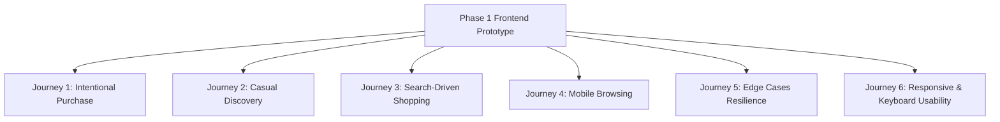

# The Nail Lounge — Phase 1 Acceptance Criteria & Verification Plan
**Document Version:** 1.0.0  
**Status:** Approved Acceptance Standard for Phase 1 Prototype  

---

## 1. Quality & Acceptance Framework

Phase 1 delivers an inspectable, responsive frontend prototype demonstrating the proposed customer experience for **The Nail Lounge**. The prototype is governed by strict acceptance criteria across 6 core journeys, 11 catalog edge cases, responsive ergonomics, and accessibility compliance.

---

## 2. Journey-by-Journey Acceptance Criteria

### Journey 1: Intentional Purchase
- **Path:** Homepage → Shop All (`/shop`) → Faceted Filter (e.g. Shape: Almond) → Product Detail Page → Select Variant → Add to Cart → Cart Drawer → Checkout Preview (`/checkout`).
- **Pass Criteria:**
  1. Filter pills accurately reduce catalog results to matching products.
  2. Navigating to PDP displays full title, gallery, price, and variant selector.
  3. Selecting a variant updates price and stock status.
  4. Clicking "Add to Bag" opens the Cart Drawer without page refresh.
  5. Cart drawer shows added item, variant title, unit price, and subtotal.
  6. Clicking "Proceed to Checkout" opens the Guest Checkout page with line items summarized.

### Journey 2: Casual Discovery
- **Path:** Homepage → Shop by Mood / Collection Tile → Collection Detail (`/collections/bridal-festive`) → Product Detail → Complementary Upsell → Cart.
- **Pass Criteria:**
  1. Homepage mood cards navigate to corresponding collection lookbook.
  2. Collection page presents thematic banner, storytelling blurb, and curated items.
  3. Clicking a product opens the PDP.
  4. Related products carousel renders at the bottom of the PDP.
  5. Tapping related item navigates smoothly to its PDP.

### Journey 3: Search-Driven Shopping
- **Path:** Search Bar (Input: "French") → Search Results Page (`/search?q=french`) → Select Match → Add to Bag.
- **Pass Criteria:**
  1. Typing in search bar matches titles, descriptions, and finish tags.
  2. Results page reflects query string ("Results for 'french'") and result count.
  3. Clicking a search result card navigates directly to that product.
  4. Testing a non-existent term (e.g. "xyz123") displays an informative empty state with popular search suggestions rather than a blank screen.

### Journey 4: Mobile Browsing
- **Path:** Mobile Homepage (375px/390px) → Category Quick-Pill → Product → Slide-up Cart Sheet → Guest Checkout.
- **Pass Criteria:**
  1. Zero horizontal overflow or content clipping on mobile viewports.
  2. Image gallery supports touch swiping and indicator dots.
  3. Sticky bottom "Add to Bag" bar slides in when the main button scrolls out of view.
  4. Cart drawer opens as a mobile-optimized bottom sheet with backdrop blur.

### Journey 5: Catalogue Edge Cases Resilience
- **Path:** Test all 11 required edge cases from `TEST_CATALOGUE_SPECIFICATION.md`:
  1. **Out of Stock (`FIX-PRS-004`):** Displays "Sold Out" badge; "Add to Bag" button is disabled; quantity selector is hidden.
  2. **Low Stock Alert (`FIX-PRS-002`):** Displays "Only 2 left" warning badge.
  3. **Unavailable Variant Combination (`FIX-PRS-003`):** Size 'L' is disabled / struck through while XS, S, M are selectable.
  4. **Single Variant (`FIX-ACC-001`):** No redundant sizing selector; direct add to bag.
  5. **No Secondary Image (`FIX-TLS-002`):** Gallery handles single photo gracefully without layout shift or broken thumbnails.
  6. **Ultra-Long Title (`FIX-PRS-018`):** Title wraps cleanly without overlapping prices or breaking grid card heights.
  7. **Empty Cart State:** Cart drawer and `/cart` page display editorial graphic and "Explore Collections" CTA.
  8. **Invalid Checkout Submission:** Submitting blank checkout form triggers inline red validation notices under missing fields without submitting.

### Journey 6: Responsive & Keyboard Usability
- **Pass Criteria:**
  1. Full keyboard navigation (`Tab`, `Shift+Tab`, `Enter`, `Space`) across header links, filter pills, variant selectors, and checkout inputs.
  2. `Escape` key dismisses open Cart Drawer and Modals.
  3. Focus outlines are clearly visible against Ivory background.
  4. Color contrast for all text over backgrounds satisfies WCAG 2.1 AA (minimum 4.5:1 ratio).
  5. Touch targets on all clickable elements exceed 44px x 44px.

---

## 3. Strict Non-Production Verification Criteria

The prototype must explicitly satisfy these non-negotiable boundaries:
- [x] No live payment gateway (Razorpay/Stripe) loaded or initialized.
- [x] No real order creation in a database.
- [x] All order confirmation screens display an explicit **"Simulated Prototype Order"** notice.
- [x] No customer registration or login screens.
- [x] Internal design system preview route (`/design-system`) is excluded from customer-facing navigation.

