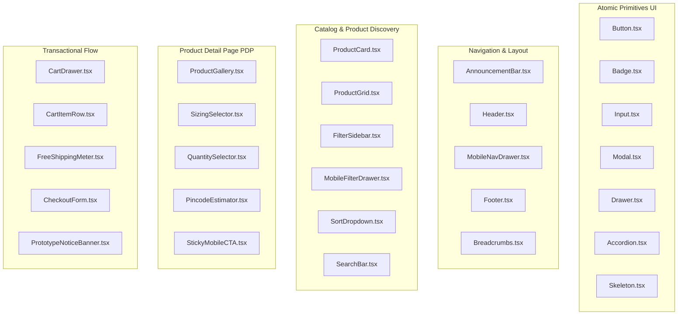

# The Nail Lounge — Phase 1 Component Inventory & Design Tokens
**Document Version:** 1.0.0  
**Status:** Approved Design System Inventory for Phase 1 Prototype  

---

## 1. Design Tokens Specification

### 1.1 Color Tokens
```css
:root {
  /* Brand Palette */
  --color-ivory: #F8F3EF;        /* Base canvas background */
  --color-ivory-dark: #F1E9E3;   /* Secondary background / subtle surfaces */
  --color-blush: #E8CFCB;        /* Pill borders, card borders, subtle accents */
  --color-blush-light: #F7EFEB;  /* Hover backgrounds on white */
  --color-rose: #A86F78;         /* Primary brand signature / Primary CTA */
  --color-rose-hover: #8F5962;   /* Primary button hover state */
  --color-espresso: #453438;     /* Primary text / Deep grounding dark */
  --color-espresso-muted: #78656A; /* Secondary text / captions / breadcrumbs */
  --color-champagne: #C3A67B;    /* Luxe metallic accents / star ratings / badges */

  /* Semantic Feedback */
  --color-success: #2D6A4F;      /* In-stock indicator, confirmed notice */
  --color-error: #BA1A1A;        /* Validation error, sold-out alert */
  --color-warning: #D97706;      /* Low-stock warning */
}
```

### 1.2 Typography Tokens
- **Editorial Headings (`font-serif`):** `Cormorant Garamond`, Georgia, serif.
- **Interface & Body (`font-sans`):** `Manrope`, system-ui, -apple-system, sans-serif.

---

## 2. Reusable Component Inventory

The prototype is built from modular, highly accessible, typed React presentation components:



### 2.1 Component Specifications

| Component Name | Category | Primary Props / State | Key Interaction & Accessibility Rules |
| :--- | :--- | :--- | :--- |
| **`Button`** | Primitive | `variant`: `'primary' \| 'secondary' \| 'outline' \| 'ghost' \| 'dark'`, `size`, `isLoading`, `fullWidth` | Enforces 44px minimum touch target on mobile; visible focus ring; aria-disabled when loading. |
| **`Badge`** | Primitive | `variant`: `'default' \| 'rose' \| 'champagne' \| 'warning' \| 'soldout'`, `label` | High-contrast label; uppercase tracking for editorial tags. |
| **`Input`** | Primitive | `label`, `error`, `icon`, standard HTML input props | Floating or explicit top label; accessible `aria-invalid` state with visible red error text. |
| **`Drawer`** | Primitive | `isOpen`, `onClose`, `title`, `position`: `'right' \| 'bottom'` | Focus trap, escape-key listener, backdrop blur, body scroll-lock when active. |
| **`Accordion`** | Primitive | `items: { id, title, content }[]`, `allowMultiple` | Accessible keyboard Enter/Space expansion; chevron rotation; `aria-expanded` attributes. |
| **`ProductCard`** | Catalog | `product: Product`, `onQuickAdd?: (product) => void` | Aspect ratio 4:5; secondary image crossfade on desktop hover; shape/finish badges; stock status indicator. |
| **`ProductGallery`** | PDP | `images: ProductImage[]`, `title: string` | Thumbnail selector on desktop; touch swipe indicators on mobile; fallback for single image (`EC-06`). |
| **`SizingSelector`** | PDP | `variants: ProductVariant[]`, `selectedVariant`, `onSelectVariant` | Shows Universal 24-piece vs Custom 10-piece (XS/S/M/L); disables unavailable combinations (`EC-05`). |
| **`FreeShippingMeter`**| Cart | `subtotal: number`, `threshold: number` | Gamified progress bar calculating amount needed for free delivery; triggers confetti/badge when unlocked. |
| **`CartDrawer`** | Cart | `isOpen`, `onClose` | Slide-out right (desktop) / bottom-sheet (mobile); live subtotal recalculation; 1-click in-cart upsells. |
| **`CheckoutForm`** | Checkout | `onSubmit: (data) => void`, `isSubmitting` | 2-step guest checkout; 6-digit Indian Pincode auto-lookup for city/state; clear prototype simulation disclaimers. |
| **`PrototypeNoticeBanner`**| Utility | Displayed on checkout and confirmation | Explicitly warns that this is a simulated development prototype with no live payments or real order placement. |

---

## 3. Brand Configurator Standard

To ensure that the brand identity and store parameters remain fully configurable without modifying individual components, all brand constants are centralized in `src/config/brand.ts`:

```typescript
export const BRAND_CONFIG = {
  name: "The Nail Lounge",
  tagline: "Artistry at Your Fingertips",
  shortDescription: "Affordable, salon-grade handcrafted press-on nails, tools, and accessories.",
  location: "Abohar, Punjab, India",
  supportEmail: "support@thenaillounge.in",
  whatsappNumber: "+91 98765 43210",
  freeShippingThreshold: 999, // Illustrative prototype value
  currencySymbol: "₹",
  currencyCode: "INR",
};
```

