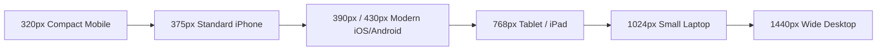

# The Nail Lounge — Responsive Design & Viewport Specifications
**Document Version:** 1.0.0  
**Status:** Approved Responsive Standard for Phase 1 Prototype  

---

## 1. Viewport Breakpoints & Spatial Hierarchy

The storefront is designed mobile-first, ensuring flawless visual hierarchy and touch usability from small budget smartphones to ultra-wide desktop monitors.



### 1.1 Responsive Breakpoint Matrix

| Viewport Width | Representative Devices | Layout Grid | Product Grid Columns | Header / Navigation Pattern | Key Ergonomic Rules |
| :--- | :--- | :---: | :---: | :--- | :--- |
| **320px** | iPhone SE (1st gen), small Androids | 4-column, 12px margin | 1 column or compact 2-col (140px min) | Compact sticky header with hamburger drawer | Reduced display font size (24px); 44px min touch target; zero horizontal scroll. |
| **375px** | iPhone 12/13 mini, iPhone SE (2nd/3rd gen) | 4-column, 16px margin | 2 columns (160px width) | Sticky header with logo, search icon, cart badge | Thumb-zone reachability: critical CTAs anchored to bottom bar. |
| **390px – 430px** | iPhone 14/15/16 Pro, Samsung Galaxy S23 | 4-column, 16px margin | 2 columns (175px width) | Sticky header + horizontal category pill scroller | Optimal mobile reading experience; 4:5 image aspect ratio. |
| **768px** | iPad Mini, iPad 10th gen, Android tablets | 8-column, 24px margin | 3 columns | Expanded top bar, collapsible search bar | Transition from mobile bottom sheet to slide-out side drawers. |
| **1024px** | iPad Pro, MacBook Air 13", Small laptops | 12-column, 32px margin | 4 columns | Full horizontal desktop menu + search input | Hover micro-interactions active; sticky PDP buy-box enabled. |
| **1440px+** | Standard Desktop, iMac, External monitors | 12-column, max-width 1280px centered | 4 columns (280px card width) | Centered 1280px container with generous side gutters | Prevents ultra-wide line length stretching; maximum editorial elegance. |

---

## 2. Touch Ergonomics & Mobile Thumb-Zone Mapping

On mobile devices (320px–430px), 80% of one-handed interactions occur in the **Natural Thumb Zone** (bottom third of the screen).

```text
+----------------------------------------+
| HARD TO REACH (Top 20%)                |
| [ Announcement Bar, Logo, Top Utility ] |
+----------------------------------------+
| COMFORTABLE TO VIEW (Middle 50%)       |
| [ Hero Imagery, Product Photo Gallery,  |
|   Pricing, Accordion Content ]         |
+----------------------------------------+
| NATURAL THUMB ZONE (Bottom 30%)        |
| [ Sticky Add to Bag Bar, Filter Trigger,|
|   Quantity Buttons, Cart Drawer Button ]|
+----------------------------------------+
```

### Mobile Ergonomic Rules:
1. **Persistent Bottom Actions:** On PDPs, when the primary "Add to Bag" button scrolls out of view, a **sticky bottom bar** slides in (`bottom: 0`, `z-index: 40`) displaying the current selected variant price and an immediate "Add to Bag" trigger.
2. **Bottom Sheet Drawers:** Filters, the sizing guide, and the cart drawer slide up as **bottom sheets** (`max-height: 85vh`) with touch swipe-to-dismiss handles on mobile, replacing awkward desktop side drawers.
3. **Generous Touch Targets:** All clickable icons, variant selector chips, quantity counters, and accordion headers have a minimum tap area of `44px x 44px`.

---

## 3. Typographic Scaling by Viewport

| Token | Desktop (>= 1024px) | Tablet (768px) | Mobile (<= 430px) | Line Height |
| :--- | :--- | :--- | :--- | :--- |
| `display-1` (Hero) | `48px / 3.0rem` | `38px / 2.375rem` | `30px / 1.875rem` | `1.15` |
| `h1` (Page Title) | `36px / 2.25rem` | `30px / 1.875rem` | `24px / 1.5rem` | `1.2` |
| `h2` (Section Title)| `28px / 1.75rem` | `24px / 1.5rem` | `20px / 1.25rem` | `1.25` |
| `h3` (Card Title) | `20px / 1.25rem` | `18px / 1.125rem` | `16px / 1.0rem` | `1.3` |
| `body-base` | `15px / 0.937rem`| `14px / 0.875rem`| `14px / 0.875rem`| `1.5` |
| `body-small` | `13px / 0.812rem`| `12px / 0.75rem` | `12px / 0.75rem` | `1.4` |

---

## 4. Layout Shift (CLS) Prevention Standard

To guarantee a Cumulative Layout Shift (CLS) score of `< 0.05`:
1. **Fixed Aspect Ratio Containers:** All product image containers enforce `aspect-ratio: 4 / 5` using CSS classes (`aspect-[4/5] overflow-hidden bg-[#F1E9E3]`). Containers reserve physical vertical space before images load.
2. **Skeleton Shimmer Placeholders:** During loading states, placeholder boxes render with exact component dimensions, preventing content jumping when data resolves.
3. **Font Fallbacks:** Web fonts (`Cormorant Garamond` and `Manrope`) are declared with font-display swap and matched fallback system font metrics (`font-serif` and `font-sans`) to eliminate layout reflow.

