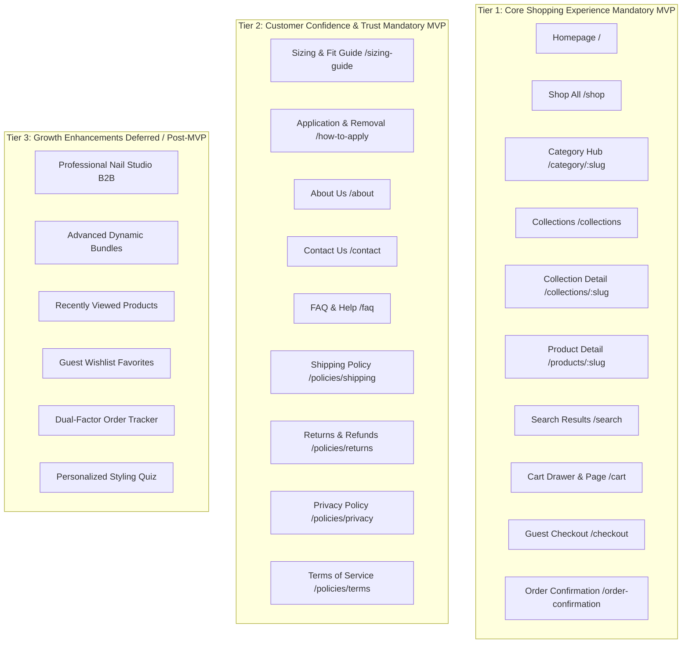

# The Nail Lounge — Phase 1 UX Strategy & Page Prioritization
**Document Version:** 1.0.0  
**Status:** Approved Architecture for Phase 1 Prototype  

---

## 1. Information Architecture Tiering & Scope Control

To prevent scope creep and ensure maximum focus on commercial conversion and customer trust, all storefront pages are organized into three distinct operational tiers.

---

## 2. Comprehensive Page-by-Page Specifications

### Tier 1: Core Shopping Experience (Mandatory MVP)

#### 1. Homepage (`/`)
1. **Purpose:** Flagship editorial storefront; introduces the brand aesthetic, establishes value proposition, and channels visitors into high-intent shopping funnels.
2. **Primary Visitor Intent:** Casual browsing, evaluating brand credibility, seeking trend inspiration.
3. **Primary CTA:** "Explore Collection" / "Shop All Nails"
4. **Secondary CTA:** "Find Your Fit (Sizing Guide)"
5. **Content Hierarchy:**
   - Announcement Area (Neutral delivery & studio dispatch note)
   - Header with category links, search trigger, and cart count
   - Editorial Hero Banner (High-impact visual, tagline, primary shopping CTA)
   - Category Quick-Pills (Press-ons, Gel Polish, Nail Art, Tools, Kits)
   - Value Proposition Strip (Multi-day wear, reusable with tabs, salon finish at home)
   - Curated Featured Collection Grid (4 representative styles with quick-add)
   - Sizing Confidence Teaser (Universal multi-size vs custom sizing)
   - Brand Heritage Snippet (Design and fulfillment from Abohar, Punjab)
   - Footer with navigation, policies, and contact channels
6. **Entry / Exit Paths:** Direct entry, social ads, organic search → Exits to `/shop`, `/collections`, `/products/:slug`.
7. **Mobile Behavior:** Full-width hero banner with 4:5 mobile crop; horizontal scrolling for category pills; sticky bottom shopping bar.
8. **States:**
   - *Empty/Loading:* Soft shimmer card skeletons.
   - *Error:* Fallback to core category links.
9. **Conversion / Trust Contribution:** First impression anchor; sets accessible luxury tone and validates Indian geographic roots.
10. **Unconfirmed Dependencies:** Approved hero banner photography; final tagline.

---

#### 2. Shop All (`/shop`)
1. **Purpose:** Comprehensive catalog enabling rapid product discovery via faceted filtering.
2. **Primary Visitor Intent:** Intentional browsing, exploring full inventory, filtering by shape/finish/price.
3. **Primary CTA:** "Add to Bag"
4. **Secondary CTA:** "Filter & Sort" (Mobile trigger)
5. **Content Hierarchy:** Breadcrumbs, Page Title, Results Count, Active Filter Tags, Desktop Sidebar / Mobile Bottom Sheet Filters, 4-Col / 2-Col Product Grid, Load More button.
6. **Entry / Exit Paths:** Header nav, homepage pills → Exits to `/products/:slug`, `/cart`.
7. **Mobile Behavior:** 2-column grid; floating bottom button opens filter drawer with tactile touch chips.
8. **States:**
   - *Empty:* "No styles match your filter selection" with "Clear All Filters" button.
   - *Loading:* 8 animated card skeletons.
9. **Conversion Contribution:** Removes cognitive friction through instant faceted filtering.
10. **Unconfirmed Dependencies:** Final product categorization and price points.

---

#### 3. Category Listing (`/category/:slug`)
1. **Purpose:** Dedicated catalog view tailored to a specific product category (Press-on Nails, Gel & Polish, Art Accessories, Tools, Care Kits).
2. **Primary Visitor Intent:** Category-specific shopping; avoids irrelevant filters (e.g. tools do not show nail shape filters).
3. **Primary CTA:** "Add to Bag"
4. **Secondary CTA:** "Filter Category"
5. **Content Hierarchy:** Category Title, Category Intro, Sub-category Chips, Filtered Grid.
6. **Entry / Exit Paths:** Main menu, homepage cards → Exits to `/products/:slug`.
7. **Mobile Behavior:** Category-specific banner collapses on scroll to prioritize product visibility.
8. **States:** Empty state with link to `/shop`.
9. **Conversion Contribution:** Prevents attribute confusion across disparate product lines.
10. **Unconfirmed Dependencies:** Final category taxonomy.

---

#### 4. Collections (`/collections`) & Collection Detail (`/collections/:slug`)
1. **Purpose:** Editorial lookbooks organizing styles by aesthetic or occasion (e.g., "The Bridal & Festive Edit", "The Minimalist Edit").
2. **Primary Visitor Intent:** Mood-based exploration; seeking an entire curated aesthetic.
3. **Primary CTA:** "View Collection" (Listing) / "Add to Bag" (Detail)
4. **Secondary CTA:** "Back to All Collections"
5. **Content Hierarchy:** Lookbook Hero Banner, Editorial Blurb, Curated Product Grid, Thematic Styling Notes.
6. **Entry / Exit Paths:** Header nav, homepage carousels → Exits to `/products/:slug`.
7. **Mobile Behavior:** Single-column narrative banner with swipeable lookbook cards.
8. **States:** Graceful fallback if collection has ended.
9. **Conversion Contribution:** Increases Average Order Value (AOV) through thematic styling inspiration.
10. **Unconfirmed Dependencies:** Final editorial collection names and lookbook photography.

---

#### 5. Product Detail Page (PDP) (`/products/:slug`)
1. **Purpose:** The decisive purchase-evaluation screen; provides comprehensive product imagery, clear variant choices, package contents, and application steps.
2. **Primary Visitor Intent:** High-intent product evaluation; verifying price, sizing, materials, and wear instructions.
3. **Primary CTA:** "Add to Bag"
4. **Secondary CTA:** "Buy Now" (Direct Checkout)
5. **Content Hierarchy:**
   - Breadcrumbs
   - 2-Column Desktop / Mobile Carousel Gallery (4:5 aspect ratio)
   - Title, Category, and Pricing (Selling Price, MRP, Savings)
   - Packaging / Set Type Selector (Multi-Size 24-pc vs Custom Sized 10-pc XS/S/M/L)
   - Specification Chips (Shape, Length, Finish — press-on products only)
   - Stock Availability Alert (In stock / Low stock / Sold out)
   - Quantity Selector & Primary "Add to Bag" Button
   - Pincode Delivery Estimator (Illustrative development helper)
   - Information Accordions: Package Contents, How to Apply, Safe Removal, Care & Quality
   - Related Products Carousel
6. **Entry / Exit Paths:** Catalog grids, search results → Exits to Cart Drawer or Direct Checkout.
7. **Mobile Behavior:** Swipeable image carousel with indicator dots; persistent sticky bottom Add to Bag bar.
8. **States:**
   - *Sold Out:* Disabled button with "Out of Stock" indicator.
   - *Unavailable Variant Combination:* Struck-through chip with warning notice.
9. **Conversion Contribution:** Direct conversion engine; answers all objections upfront.
10. **Unconfirmed Dependencies:** Confirmed packaging contents, real photos, verified MRPs.

---

#### 6. Search Results (`/search`)
1. **Purpose:** Connects keyword-searching visitors directly to relevant products with typo-tolerant matching.
2. **Primary Visitor Intent:** Specific, high-intent product query (e.g. "french", "almond", "glue").
3. **Primary CTA:** "Add to Bag"
4. **Secondary CTA:** "Clear Search"
5. **Content Hierarchy:** Search Input Bar, Result Query String, Product Grid, Zero-Results Recommendations.
6. **Entry / Exit Paths:** Header search bar → Exits to `/products/:slug`.
7. **Mobile Behavior:** Full-screen search input with instant results rendering below.
8. **States:**
   - *Zero Results:* "No styles matched your search" followed by popular category chips and featured products.
9. **Conversion Contribution:** Captures high-intent search traffic without dead ends.
10. **Unconfirmed Dependencies:** Search synonyms and indexing terms.

---

#### 7. Cart Drawer & Full Cart Page (`/cart`)
1. **Purpose:** Immediate visual feedback upon item addition; enables rapid quantity adjustments and review before checkout.
2. **Primary Visitor Intent:** Reviewing selected items, verifying order subtotal, advancing to payment.
3. **Primary CTA:** "Proceed to Checkout"
4. **Secondary CTA:** "Continue Shopping"
5. **Content Hierarchy:** Header with item count, Free Shipping Progress Meter (Illustrative), Line Items Table, In-Cart 1-Click Complementary Add-ons, Order Subtotal, Checkout Button, Trust Badges.
6. **Entry / Exit Paths:** Any page Add to Bag action → Exits to `/checkout`.
7. **Mobile Behavior:** Bottom-sheet drawer sliding up smoothly; full-screen cart review page.
8. **States:**
   - *Empty:* "Your shopping bag is empty" with "Explore Bestsellers" CTA.
9. **Conversion Contribution:** Low-friction drawer keeps context alive; in-cart upsells increase Units Per Transaction (UPT).
10. **Unconfirmed Dependencies:** Approved free shipping threshold and shipping rate policy.

---

#### 8. Guest Checkout (`/checkout`)
1. **Purpose:** Seamless, guest-only purchase finalization without mandatory login or account creation.
2. **Primary Visitor Intent:** Entering delivery information and confirming order.
3. **Primary CTA:** "Place Simulated Order" (Prototype state)
4. **Secondary CTA:** "Return to Shopping Bag"
5. **Content Hierarchy:**
   - Minimal Distraction-Free Header
   - Prototype Notice Banner ("Simulated Prototype Checkout — No real charges will occur")
   - Step 1: Contact Information (WhatsApp/Phone, Email, Full Name)
   - Step 2: Delivery Address (House/Street, 6-digit Pincode with City/State auto-fill, Landmark)
   - Step 3: Payment Method (Simulated COD / Simulated Online Gateway)
   - Order Summary Sidebar (Line items, subtotal, shipping, total)
6. **Entry / Exit Paths:** Cart drawer → Exits to Prototype Order Confirmation.
7. **Mobile Behavior:** Single-column vertical accordion with large touch-friendly inputs.
8. **States:** Real-time inline field validation; disabled place order button while submitting.
9. **Conversion Contribution:** Eliminates the #1 e-commerce drop-off point (mandatory registration).
10. **Unconfirmed Dependencies:** Approved payment gateway and COD policy.

---

#### 9. Order Confirmation (`/order-confirmation/:orderNumber`)
1. **Purpose:** Confirms order receipt, provides tracking preview, and provides post-purchase reassurance.
2. **Primary Visitor Intent:** Verifying order placement, saving reference number, understanding delivery timeline.
3. **Primary CTA:** "Continue Browsing"
4. **Secondary CTA:** "Download Care & Application Guide"
5. **Content Hierarchy:**
   - Prototype Confirmation Notice (Explicitly marked as simulated development order)
   - Order Reference Number (`TNL-DEV-XXXXX`)
   - Estimated Delivery Window (Illustrative)
   - Customer Contact & Delivery Address Summary
   - Ordered Items Breakdown & Paid Total
   - WhatsApp Support Direct Link
6. **Entry / Exit Paths:** Checkout submission → Exits to `/shop` or `/sizing-guide`.
7. **Mobile Behavior:** Clean vertical receipt card with copy-to-clipboard order number button.
8. **Conversion / Trust Contribution:** Eliminates buyer remorse and establishes approachable support.
9. **Unconfirmed Dependencies:** Order confirmation transactional email/SMS templates.

---

### Tier 2: Customer Confidence & Trust (Mandatory MVP)

- **Sizing & Fit Guide (`/sizing-guide`):** Step-by-step visual measuring tutorial (tape & ruler method), standard millimeter chart for XS/S/M/L, and explanation of multi-size sets.
- **Application & Removal Guide (`/how-to-apply`):** Differences between adhesive tabs (temporary wear, reusable) and nail glue (extended wear); damage-free warm water soaking removal steps.
- **About Us (`/about`):** Brand narrative highlighting Abohar design studio roots, quality promise, and accessible luxury philosophy.
- **Contact Us (`/contact`):** WhatsApp Business click-to-chat, email support, studio address, and customer inquiry form.
- **FAQ & Help (`/faq`):** Common questions on wear duration, sizing, water resistance, and delivery timelines.
- **Legal Policies (`/policies/*`):** Shipping Policy, Returns & Refund Policy, Privacy Policy, Terms & Conditions (with explicit placeholders for unconfirmed legal details).

---

### Tier 3: Growth Enhancements (Deferred / Post-MVP)

- **Professional Nail Studio B2B (`/nail-studio`):** Deferred until wholesale pricing and bulk supply terms are established.
- **Automated Co-Occurrence Recommendations:** Deferred until sufficient real order history exists; prototype uses manual curated pairings.
- **Client-Side Wishlist & Recently Viewed:** Evaluated as optional lightweight enhancements; implemented locally in browser storage without backend dependency.
- **Order Tracker:** Replaced in MVP with direct customer service contact links until courier API webhooks are active.

