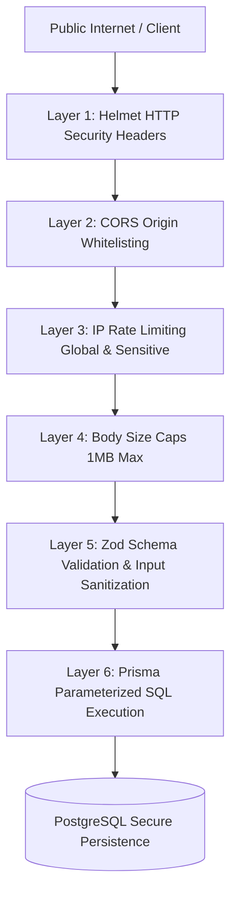

# The Nail Lounge — Phase 2: Security Baseline Assessment

**Document Version:** 1.0.0  
**Phase:** Phase 2 (Technical Foundation)  
**Security Lead:** Senior Application Security Engineer & Technical Lead  
**Scope:** Backend Express API, Database Connectivity & Cross-Origin Storefront Boundaries  

---

## 1. Security Threat Model & Defense-in-Depth

The technical foundation implements defense-in-depth across six distinct layers:

---

## 2. Implemented Security Controls

### 2.1 HTTP Security Headers (`helmet`)
Integrated via `helmet()` in `backend/src/app.ts`:
- **`Content-Security-Policy`**: Restricts origins for scripts, styles, and frames.
- **`Strict-Transport-Security` (HSTS)**: Forces HTTPS enforcement in production environments.
- **`X-Content-Type-Options: nosniff`**: Prevents MIME-type sniffing exploits.
- **`X-Frame-Options: SAMEORIGIN`**: Protects against clickjacking.
- **`X-Download-Options: noopen`**: Prevents direct execution of downloaded HTML/scripts in older IE.
- **`X-Permitted-Cross-Domain-Policies: none`**: Blocks Flash/PDF policy escalation.
- **`Referrer-Policy: no-referrer`**: Prevents leakage of internal URL tokens in referrer headers.

### 2.2 Cross-Origin Resource Sharing (CORS) Policy
- Dynamic origin validator checks against allowed origins (`FRONTEND_ORIGIN`, `http://localhost:3000`).
- Untrusted origins attempting cross-origin requests receive an explicit CORS rejection before route processing.
- Non-browser requests without origin headers (e.g. server-to-server health probes, mobile apps, or curl) are permitted for diagnostic monitoring.
- Credentials (`Access-Control-Allow-Credentials: true`) are strictly scoped to the whitelisted domain.

### 2.3 Tiered Rate Limiting Protection
Defends against brute-force attacks, resource exhaustion, and automated credential or inventory probing:
1. **Global Rate Limiter:** 100 requests per 15 minutes per IP (configurable via `RATE_LIMIT_MAX_REQUESTS` / `RATE_LIMIT_WINDOW_MS`). Returns `429 Too Many Requests` with `Retry-After`.
2. **Sensitive Rate Limiter:** 20 requests per 15 minutes per IP for checkout submissions, order lookups, and pincode verification.

### 2.4 Payload Size Caps & Denial of Service Mitigation
- Request bodies are strictly restricted to **1MB** (`express.json({ limit: "1mb" })` and `express.urlencoded({ extended: true, limit: "1mb" })`).
- Requests with excessively large JSON bodies are immediately aborted with `413 Payload Too Large`.
- Malformed JSON triggers `SyntaxError` which is caught by `errorMiddleware` returning `400 MALFORMED_JSON` without crashing the Node.js event loop.

### 2.5 Information Disclosure Mitigation
- **Stack Trace Suppression:** In `production` mode (`NODE_ENV=production`), detailed error stacks are stripped from API error envelopes; only generic sanitized messages are returned to clients.
- **Health Probe Sanitization:** `/api/v1/health` and `/api/v1/ready` intentionally expose only binary status codes, uptime, and database latency. Connection strings, hostnames, passwords, and internal configuration keys are never returned.
- **Console Log Hygiene:** Passwords, tokens, and credit card numbers are excluded from structured loggers.

### 2.6 SQL Injection Prevention
- All database operations utilize Prisma ORM, which generates strictly parameterized SQL queries. Raw string concatenation in database calls is forbidden.
- UUID primary keys prevent predictable numeric ID enumeration attacks across customers and orders.

### 2.7 Guest Checkout Data Protection
- Guest checkout eliminates stored passwords, neutralizing customer credential leak risks.
- Orders are generated with a high-entropy UUID `orderAccessToken`. A customer viewing their order confirmation via `/order-confirmation/[orderNumber]` must provide the token, preventing unauthorized public scraping of customer phone numbers or delivery addresses.

