# The Nail Lounge — Product Requirements Document (PRD)
**Document Version:** 1.0.0  
**Status:** Approved Blueprint for Phase 0  
**Target Market:** India (D2C E-Commerce)  
**Base Location:** Abohar, Punjab, India  

---

## 1. Executive Summary & Brand Identity

### 1.1 Brand Identity
- **Brand Name:** The Nail Lounge *(Configurable via application constants/environment)*
- **Tagline:** *Artistry at Your Fingertips*
- **Positioning:** Affordable but premium-looking beauty brand specializing in handcrafted and salon-grade press-on nails, tools, and accessories.
- **Geographic Roots:** Abohar, Punjab, India. The brand honors local artisan craftsmanship while delivering nationwide across India via modern digital commerce.

### 1.2 Core Value Proposition
The Nail Lounge aims to provide an accessible alternative to salon nail appointments and generic drugstore plastic tips. By offering curated, multi-size and sized press-on nail sets alongside application accessories, customers can achieve salon-inspired manicures at home. Wear duration and reusability depend on proper nail preparation and adhesive choice (temporary adhesive tabs vs. extended-wear nail glue).

### 1.3 Key Differentiators
1. **Curated Aesthetic & Flexible Sizing Models:** Distinct from mass-market plastic tips; offers distinct shapes, finishes, and clear sizing guidance across both multi-size universal sets and custom-measured sets.
2. **Accessible Luxury:** Editorial beauty presentation and high-touch customer care at an accessible price point for Indian shoppers (Tier 1 to Tier 3 cities).
3. **Dual Market Coverage:** Caters to both retail beauty enthusiasts (B2C) and professional nail technicians/salons seeking accessories and kits (Pro/B2B).

---

## 2. Commercial Objectives & Target Metrics

The storefront is engineered to serve two primary visitor mindsets:
1. **Intentional Shoppers:** Visitors seeking a specific style, occasion look (bridal, festive, party), or nail care kit. Focus: frictionless discovery, transparent specifications, rapid guest checkout.
2. **Casual Browsers:** Visitors discovering the brand via social media (Instagram/Meta ads, influencer unboxings). Focus: high-impact visual storytelling, occasion-based moodboards, and impulse-friendly cart bundles.

### Commercial Target Metrics (Optimization Goals)
> *Note: These are aspirational design optimization targets, not verified performance forecasts.*

| Metric | Target Benchmark | Architectural & Design Focus |
| :--- | :--- | :--- |
| **Storefront Conversion Rate (CVR)** | > 2.5% on mobile | Streamlined 2-step guest checkout, thumb-friendly UI, sticky CTAs |
| **Average Order Value (AOV)** | Target ₹1,000+ | Configurable free shipping progress bar, bundled prep kits |
| **Units Per Transaction (UPT)** | 2.0+ items/order | In-cart complementary upsells (glue tabs, cuticle oils, remover) |
| **Checkout Abandonment Rate** | Minimize (< 65%) | Frictionless guest checkout (no mandatory account creation), upfront shipping info |
| **Return-to-Origin (RTO) Rate** | Minimize (< 10%) | Pincode serviceability checks, address validation, clear sizing instructions |

### Ethical Persuasion Policy
The platform strictly forbids deceptive dark patterns:
- **No Fabricated Urgency:** No fake countdown timers, false "12 people looking at this" toasts, or simulated stock scarcity.
- **Genuine Inventory Alerts:** Low-stock warnings appear **only** when backend inventory falls below actual threshold levels (e.g., `<= 3 units`).
- **No Fabricated Social Proof:** Zero fake reviews, bot testimonials, or artificial star ratings. Verified customer reviews only.
- **Transparent Pricing:** All discounts reflect genuine differences between Maximum Retail Price (MRP) and Selling Price (Effective Price), in compliance with Indian Consumer Protection (E-Commerce) Rules, 2020.

---

## 3. User Personas

### Persona A: "Aanya" — The Trendy College Student / Gen Z Fashionista
- **Demographics:** Age 19–24, urban/semi-urban college student, active Instagram/Pinterest user.
- **Pain Points:** Salons cost ₹1,500–₹3,000 per set and take 2 hours. Nails chip quickly during daily commutes.
- **Needs:** Fun, expressive, switchable nail sets (Coquette, Chrome, Y2K) under ₹800 that can be applied before a weekend party and removed for classes.
- **Shopping Behavior:** Mobile-first, responds to visual reels/moods, prefers UPI payment, browses during late evening.

### Persona B: "Simran" — The Bride-to-be / Wedding Guest
- **Demographics:** Age 26–32, working professional in Chandigarh/Delhi, preparing for multiple wedding functions.
- **Pain Points:** Traditional salon extensions ruin natural nails and take hours during hectic wedding schedules.
- **Needs:** Elegant, durable, high-end bridal nail sets with intricate embellishments, pearls, and glossy finishes; matching sets for bridesmaids.
- **Shopping Behavior:** Seeks high-resolution zoom imagery, precise sizing reassurance, fast express courier delivery.

### Persona C: "Pooja" — The Freelance Nail Artist / Salon Owner
- **Demographics:** Age 25–40, independent nail studio artist in Punjab/North India.
- **Pain Points:** Difficult to source reliable, consistent nail art tools, practice tips, UV gel supplies, and prep essentials locally in Abohar or smaller towns.
- **Needs:** Reliable bulk purchasing, professional tools (buffers, cuticle oils, acrylic brushes, display stands), and wholesale kit pricing.
- **Shopping Behavior:** Desktop/tablet user, searches by technical SKU/specs, requires GST tax invoices.

---

## 4. Product Catalog Scope

```mermaid
graph TD
    Catalog[The Nail Lounge Catalog]
    
    Catalog --> Cat1[1. Press-On Nails Primary]
    Catalog --> Cat2[2. Nail Art & Accessories]
    Catalog --> Cat3[3. Polish & Gel Systems]
    Catalog --> Cat4[4. Tools & Equipment]
    Catalog --> Cat5[5. Prep & Care Kits]
    
    Cat1 --> Sub1A[Everyday Minimalist]
    Cat1 --> Sub1B[Bridal & Festive Extravaganza]
    Cat1 --> Sub1C[Glam & Statement]
    Cat1 --> Sub1D[Custom Sized Sets]
    
    Cat2 --> Sub2A[Nail Charms & Rhinestones]
    Cat2 --> Sub2B[Stickers & Water Decals]
    Cat2 --> Sub2C[Foil & Chrome Pigments]
    
    Cat3 --> Sub3A[Classic Lacquers]
    Cat3 --> Sub3B[UV Gel Polishes]
    Cat3 --> Sub3C[Top & Base Coats]
    
    Cat4 --> Sub4A[Cuticle Pushers & Clippers]
    Cat4 --> Sub4B[Buffers & Files]
    Cat4 --> Sub4C[Mini UV/LED Curing Lamps]
    
    Cat5 --> Sub5A[Complete Application Kits]
    Cat5 --> Sub5B[Adhesive Tabs & Liquid Glue]
    Cat5 --> Sub5C[Nourishing Cuticle Oils]
```

### 4.1 Product Categories & Definitions
1. **Press-on Nails (Hero Category):** Press-on tips in multiple shapes (Almond, Coffin, Square, Oval, Stiletto) and lengths (Short, Medium, Long). Can be configured as **Multi-Size 24-Piece Sets** (multiple sizes to fit many finger widths without measuring) or **Custom Sized Sets** (requires customer size selection: XS, S, M, L).
2. **Nail Art Accessories:** Rhinestone gems, 3D metallic charms, chrome powders, foil flakes, striping tape, and French tip guides.
3. **Nail Polish and Gel Polish:** Highly pigmented lacquers and UV/LED gel polishes.
4. **Nail Art Tools:** Precision detail brushes, dotting tools, glass files, dual-ended cuticle pushers, mini portable UV flash-cure lamps.
5. **Nail Prep & Care Kits:** Dehydrating alcohol prep wipes, brush-on liquid nail glue, extra-strength jelly glue tabs, and cuticle revival oils.

---

## 5. Functional Requirements Overview

### 5.1 Product Discovery & Navigation
- **Multi-Level Taxonomy:** Structured Categories, Curated Collections, and Faceted Filters.
- **Faceted Attributes:** Real-time filtering by Shape (Almond, Coffin, Square), Length (Short, Medium, Long), Finish (Glossy, Matte, Chrome, Glazed), Color Family, and Occasion (for press-on items only). Non-press-on items filter by relevant attributes (Volume, Tool Type, etc.).
- **Search System:** Typo-tolerant keyword search across title, tags, shape, finish, and category with search-as-you-type quick suggestions.

### 5.2 Product Detail Experience (PDP)
- Multi-angle high-resolution media gallery with thumbnail carousel and pinch/hover zoom.
- Interactive Sizing Selector with clear distinction between Multi-Size Universal Sets (simplified sizing) and Custom Sized Sets (XS, S, M, L) with measurement modal.
- Live stock availability indicator per variant.
- Indian Pincode delivery estimator (illustrative development helper).
- Complete Package Contents breakdown (e.g., "Set includes: 24 nails, 1 nail glue, 24 jelly tabs, 1 cuticle stick, 1 mini buffer, 2 prep pads").
- Step-by-step Application & Safe Removal drawer (with warm water soaking instructions).
- Compliance disclosures (Net quantity, manufacturer/packer details, customer care).

### 5.3 Cart & Merchandising
- **Slide-out Cart Drawer (Mini-cart):** Opens seamlessly upon adding an item without forcing a page redirect.
- **Configurable Free Shipping Bar:** Dynamically calculates remaining amount needed for free shipping based on configured threshold.
- **1-Click In-Cart Add-ons:** Curated high-margin impulse items (e.g., "Extra Jelly Tabs Sheet", "Cuticle Oil Pen").
- **Client-Side Persistence:** Guest cart persists across browser sessions using `localStorage` with server-side synchronization upon checkout initialization.

### 5.4 Guest Checkout Experience
- **Zero Registration Gate:** No account creation required. Shopper enters email/phone and shipping address directly.
- **Clean 2-Step Accordion Flow:**
  - *Step 1:* Delivery Address & Contact (with automatic Indian State/City lookup via 6-digit Pincode).
  - *Step 2:* Shipping Method & Order Summary Review.
- **Order Confirmation:** Immediate visual receipt with unique Order Number and secure unguessable access token (`orderAccessToken`), WhatsApp notification opt-in, and downloadable Care Guide.

---

## 6. Non-Functional Requirements

### 6.1 Performance & Core Web Vitals
- **Target LCP (Largest Contentful Paint):** `< 1.8 seconds` on 4G mobile devices.
- **Target FID / INP (Interaction to Next Paint):** `< 100 milliseconds`.
- **Target CLS (Cumulative Layout Shift):** `< 0.05`.
- **Media Optimization:** Next.js automatic image optimization serving modern WebP/AVIF formats via Cloudinary CDN with explicit width/height dimensions to prevent layout shifts.

### 6.2 Regulatory & Indian E-Commerce Compliance
- **Legal Metrology (Packaged Commodities) Rules:** Display of MRP, Net Quantity, Country of Origin, Manufacturer/Packer details, and Consumer Care Contact.
- **Consumer Protection (E-Commerce) Rules, 2020:** Clear refund/exchange policy, explicit delivery timelines, and genuine pricing without deceptive discount anchors.
- **Digital Personal Data Protection (DPDP) Act:** Explicit consent for marketing communications, secure handling of customer phone numbers and delivery addresses, and transparent privacy policy.

### 6.3 Security & System Integrity
- All communication strictly over HTTPS/TLS 1.3.
- Rate limiting on API endpoints to prevent scraper abuse and denial of service.
- Input validation on both client and backend using typed schema validators (Zod).
- Zero database exposure to the public internet; backend operates as a secure gateway.

---

## 7. Scope Boundaries: Phased Implementation Matrix

| Capability / Module | Phase 0 (Blueprint & Remediation) | Phase 1 (UX & Visual Prototype) | Phase 2–4 (Backend & Production Storefront) | Phase 5–7 (Checkout, Orders & Payments) | Post-Launch (Growth Phase) |
| :--- | :---: | :---: | :---: | :---: | :---: |
| Architecture & Remediation | **Completed** | Maintained | Maintained | Maintained | Maintained |
| Responsive Visual Prototype | Planned | **Completed** | Connected to API | Live | Enhanced |
| Test Fixture Catalogue (36 Items) | Planned | **Completed** | Seeded in DB | Replaced by Real Data | Dynamic |
| PostgreSQL & Prisma Migrations | Out of Scope | Strictly Out of Scope | **Phase 2 Scope** | Maintained | Scaled |
| Production REST APIs (Express) | Out of Scope | Strictly Out of Scope | **Phase 3 Scope** | Maintained | Scaled |
| Real Guest Checkout & Order DB | Out of Scope | Simulated Prototype Only | Scaffolded | **Phase 5/6 Scope** | Enhanced |
| Live Payment Gateway (Razorpay/UPI) | Out of Scope | Strictly Out of Scope | Out of Scope | **Phase 7 Scope** | Managed |
| Customer Login & Dashboard | Out of Scope | Strictly Out of Scope | Out of Scope | Out of Scope | Future Growth |
| Merchant Admin Dashboard | Out of Scope | Strictly Out of Scope | Out of Scope | Out of Scope | Future Growth |

