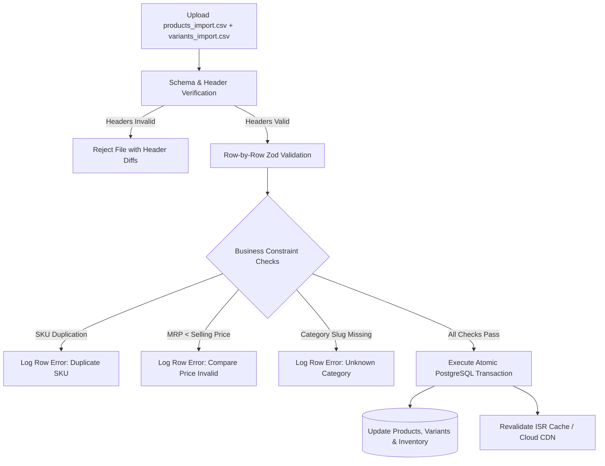
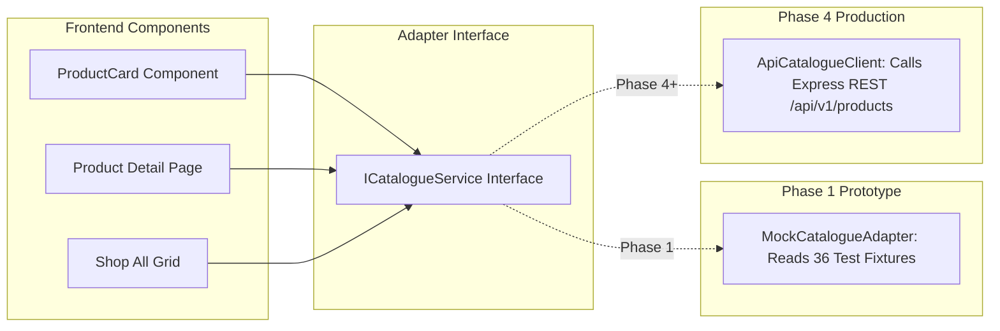

# The Nail Lounge — Real Catalogue Import Specification
**Document Version:** 1.0.0  
**Status:** Approved Migration Plan for Phase 3/4  
**Target Execution:** Phase 3 (Backend Catalogue) & Phase 4 (Storefront Production Data)  

---

## 1. Migration Overview & Objective

During Phase 1 (current prototype) and early development, the platform consumes deterministic mock fixtures. When actual business photography, finalized retail pricing, supplier packaging models, and physical warehouse inventory become available, the system must ingest this real catalog without requiring structural code modifications or frontend refactoring.

This document establishes the **standard CSV import contract**, validation schemas, and database mapping rules.

---

## 2. Standard CSV Import Schema

The catalog import pipeline operates on two normalized CSV files:
1. `products_import.csv` (Parent product identity, descriptions, category, collections, and compliance).
2. `variants_import.csv` (SKUs, options, pricing, barcodes, and inventory levels).

### 2.1 File 1: `products_import.csv` Specification

| Column Header | Data Type | Required | Validation Rules | Description & Examples |
| :--- | :--- | :---: | :--- | :--- |
| `product_handle` | `VARCHAR(150)` | YES | Unique, kebab-case regex `^[a-z0-9-]+$` | URL slug (e.g. `glazed-rose-almond`) |
| `name` | `VARCHAR(255)` | YES | Min length 3, max length 200 | Display title (e.g. `Glazed Rose Chrome Almond`) |
| `category_slug` | `VARCHAR(100)` | YES | Must match active Category `slug` | e.g. `press-on-nails`, `nail-tools` |
| `collection_slugs` | `TEXT` | NO | Pipe-delimited list of collection slugs | e.g. `minimalist-edit\|bridal-festive` |
| `short_description`| `VARCHAR(500)` | NO | Plain text teaser | Brief summary for social and cards |
| `description` | `TEXT` | YES | HTML or Markdown supported | Full editorial description |
| `package_contents` | `TEXT` | NO | Pipe-delimited list of items included | e.g. `24 Nails\|1 Liquid Glue\|1 Buffer` |
| `application_guide`| `TEXT` | NO | Step-by-step instructions | Text or Markdown |
| `removal_guide` | `TEXT` | NO | Safe removal steps | Text or Markdown |
| `country_of_origin`| `VARCHAR(100)` | YES | Default `India` | Indian Legal Metrology requirement |
| `manufacturer_details`| `TEXT` | YES | Legal business name & city | Legal Metrology compliance |
| `primary_image_url`| `VARCHAR(500)` | YES | Valid HTTPS or Cloudinary public ID | Primary thumbnail photo |
| `gallery_image_urls`| `TEXT` | NO | Pipe-delimited URLs / Cloudinary IDs | e.g. `https://.../img1.webp\|https://.../img2.webp` |
| `status` | `VARCHAR(20)` | YES | `DRAFT` or `PUBLISHED` | Publication state |

---

### 2.2 File 2: `variants_import.csv` Specification

| Column Header | Data Type | Required | Validation Rules | Description & Examples |
| :--- | :--- | :---: | :--- | :--- |
| `product_handle` | `VARCHAR(150)` | YES | Must match `product_handle` in products CSV | Foreign key reference |
| `sku` | `VARCHAR(100)` | YES | Unique, uppercase alphanumeric `^[A-Z0-9-_]+$`| Unique SKU (e.g. `TNL-ALM-RCR-UNI24`) |
| `variant_title` | `VARCHAR(150)` | YES | Free text | e.g. `Universal 24-Piece Set` |
| `option1_name` | `VARCHAR(50)` | NO | e.g. `Size`, `Volume`, `Color` | Primary option attribute name |
| `option1_value` | `VARCHAR(100)` | NO | e.g. `Universal 24 Pcs`, `XS`, `15ml` | Primary option value |
| `option2_name` | `VARCHAR(50)` | NO | e.g. `Shape` | Secondary option attribute name |
| `option2_value` | `VARCHAR(100)` | NO | e.g. `Almond`, `Coffin` | Secondary option value |
| `option3_name` | `VARCHAR(50)` | NO | e.g. `Finish` | Tertiary option attribute name |
| `option3_value` | `VARCHAR(100)` | NO | e.g. `Chrome Glazed`, `Velvet Matte` | Tertiary option value |
| `selling_price_inr`| `DECIMAL(10,2)`| YES | Non-negative numeric (`>= 0.00`) | Customer price in INR (e.g. `899.00`) |
| `compare_at_price_inr`| `DECIMAL(10,2)`| NO | If present, must be `>= selling_price` | Maximum Retail Price (MRP) in INR |
| `initial_inventory`| `INTEGER` | YES | Non-negative integer (`>= 0`) | Available warehouse stock |
| `low_stock_alert` | `INTEGER` | NO | Default 3 | Threshold for "Only X left" badge |

---

## 3. Validation Pipeline & Error Handling

### Pre-Import Validation Rules:
1. **Atomic Ingestion:** Imports execute within an atomic PostgreSQL transaction. If any row fails validation, the transaction rolls back completely to prevent half-imported, orphaned products.
2. **Pricing Integrity Check:** `compare_at_price_inr` must strictly be greater than or equal to `selling_price_inr` to prevent fraudulent discount flags under Indian consumer protection laws.
3. **Handle Consistency:** Every `product_handle` in `variants_import.csv` must resolve to an existing `product_handle` in `products_import.csv`.
4. **Media Accessibility:** The importer performs HEAD requests against all image URLs to verify they are reachable before committing records.

---

## 4. Architectural Decoupling: Transition from Mock to Live Data

Because frontend presentation components communicate strictly with the `ICatalogueService` interface, replacing the development fixture catalog with the real production API in Phase 4 requires **zero component rewrites**.

